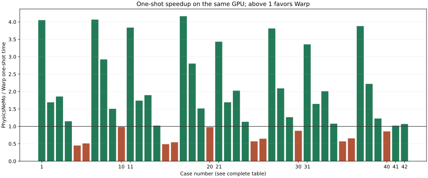
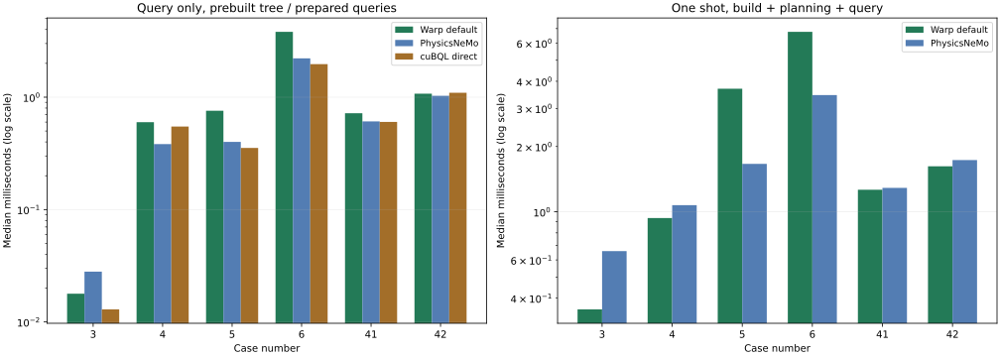

# Exact point-cloud nearest neighbors in Warp

**Warp-only batch API:** [Automatic tuning and fused scalar use](batch/README.md) exposes the measured launch policy through `wp.point_query_knn_batch()` and `wp.point_query_config()`, with no Torch dependency.

**Updated GPU comparison:** [November 12 comparison](refresh/README.md) remeasures simple scalar calls, tuned scalar calls, and the automatic batch API, including CUDA graph replay. Unchanged competitor timings are retained and clearly labeled.

**Geometry and scheduling investigation:** [Comparing and improving Warp and PhysicsNeMo](hybrid/README.md) retains the adaptive BVH and heap, fixes anisotropic Morton scaling, and generalizes sparse query launches. Configured Warp beats pinned PhysicsNeMo in 40/40 pilot and 56/56 holdout cases; equally tuned PhysicsNeMo nearly ties the million-point Q=8,192 regime. Warp now beats direct-L2 cuVS in all 16 medium k=32 cases; tiny cases still favor cuVS. Earlier measurements below remain historical.

**Earlier broad comparison:** [Twelve configurations across seven competing GPU libraries and 40 scan/surface/volume cases](comparison/README.md) finds configured Warp fastest one-shot in 16/40 cases. Direct-L2 cuVS wins the medium k=32 cases; the earlier PhysicsNeMo-only results below remain historical measurements.

**Follow-up:** [Profile-guided optimization of the 12 losses](optimization/README.md) improves all 12 and reaches 41/42 wins with explicit workload configurations (31/42 with the original configuration). [The case-25 allocator investigation](optimization/case25/README.md) reaches 42/42 with explicit memory retention. The report below preserves the original baseline measurements.

Temporary report bundle. [Download the HTML version](report.html) to view it locally.

Implemented the design on the existing `wp.Bvh`. The default one-shot implementation is faster than the pinned PhysicsNeMo PR in **30/42 measured cases**, with a **1.45× geometric-mean speedup** across this chosen matrix.

This is a workload-dependent improvement. All eight million-point one-shot cases remain slower than PhysicsNeMo, by up to 2.22×. The PR also wins many query-only comparisons. The 42-case aggregate is not a universal speed guarantee or a reproduction of its GB300 / 17.7-million-point DoMINO record.

[Build and reproduction instructions](reproduce.rst) · [Full GPU samples](results.json) · [CPU samples](results-cpu.json) · [Tiles, motion and memory](tuning.json) · [Implementation commit](https://github.com/alecjacobson/warp/commit/5e2f400d063b14f7034b7802746547e8a5fda748)

## Implemented contract

The public kernel functions are `point_query_nearest`, `point_query_knn`, and `point_query_next`. They accept an existing BVH ID and an explicit contiguous vec3 point array. The kNN state is private, inferred, and specialized by positive compile-time k. Selection completes before iteration, emits original point indices in (squared distance, index) order, applies a strict cutoff and optional index exclusion, and returns partial results without padding the iterator.

The native implementation uses a near-first traversal, a shrinking bound, a bounded max heap followed by heapsort, and a scalar k=1 specialization. A checked traversal-stack overflow clears candidates and restarts with an exhaustive scan. The shared float32 primitive/bound helper avoids inconsistent FMA rounding. Selection allocates no device heap memory and introduces no host synchronization. Empty-BVH creation/refit/rebuild/iteration needed small fixes in the existing BVH implementation.

Gather and distance operations remain differentiable; discrete selection has no derivative. Fused forward replay and a stored-index gather path are tested. Refit/rebuild or point mutation between forward and backward remains unsupported. The API requires a matched BVH/point array, valid exclusion index, finite points, and a representable distance scale. It is an exact search under the documented float32 arithmetic, not an exact-real-arithmetic predicate.

[API guide and examples](../../docs/user_guide/point_queries.rst) · [Native implementation](../../warp/native/point_query.h) · [Tests](../../warp/tests/geometry/test_point_query.py)

## Validation

- 22 new CPU/CUDA test groups and 56 existing BVH, grouped-BVH and mesh-query regression tests passed (78 total).
- Coverage includes all supported builders, leaf sizes 1/4/8, empty and small clouds, k > N, duplicates and deterministic ties, strict cutoff boundaries, exclusions, nonfinite queries, line/plane/grid data, dense clusters, sparse outliers, forced stack overflow, nested functions, state copies, exhaustion, analytic and finite-difference gradients, streams, captured graphs, motion and refit/rebuild.
- Ordinary, sorted-selector, expanding-sphere, cooperative tiled, split-reference and batched-query-tile baselines passed correctness tests, including padded reference/query tails.
- The separately compiled direct-cuBQL adaptation passed 60 additional edge-case checks.
- Every timed variant checks up to 32 evenly spaced query rows against exhaustive float32 and float64 oracles. All recorded mismatch counts are zero. Larger timed clouds are sampled for correctness; this is not a check of every timed output.
- Final generated-file, formatting and lint checks pass. The documentation build completes without warnings.

[New tests](test-point-query.log) · [Regression tests](test-regressions.log) · [cuBQL checks](test-cubql.log) · [Lint](lint.log) · [Docs build](docs.log)

## Measurement protocol and data

| Field | Value |
| --- | --- |
| device | NVIDIA RTX PRO 6000 Blackwell Server Edition MIG 1g.24gb |
| arch | 120 |
| warp\_base\_revision | 18c936d4390e3ff1a91eb7a7ecc9668e425e2c52 |
| physicsnemo\_revision | bc1c912528f0409c6853dbd33e00346a9184185c |
| python | 3.12.15 |
| numpy | 2.5.3 |
| repeats | 7 |
| scan\_sha256 | b94e0146c1d48c5edfc11af71b4af39ffca604485668c55a127c3b43203a6bd5 |
| physicsnemo\_source\_sha256 | 01255c7377bcb65aa13d5c6d75acd5ef346a1799e014b410974bf6205506b85c |

The GPU is a 46-SM NVIDIA RTX PRO 6000 Blackwell Server Edition MIG 1g.24gb slice. Native build: CUDA 12.9, driver 595.91.07 / CUDA driver API 13.2, Warp 1.20.0.dev0. PyTorch 2.7.1+cu128 supplies the pinned PR adapter. [PhysicsNeMo PR 2112](https://github.com/NVIDIA/physicsnemo/pull/2112) is compared on this same GPU. Only two framework imports were replaced with a minimal stream/validation shim; its tree and query algorithms are unchanged. The [pinned baseline source](https://github.com/NVIDIA/physicsnemo/blob/bc1c912528f0409c6853dbd33e00346a9184185c/physicsnemo/nn/functional/neighbors/knn/_warp_impl.py) is downloaded and adapted by the [benchmark harness](../../warp/examples/benchmarks/benchmark_point_query.py); its original SHA256 is recorded above.

Surface samples are random points on a unit sphere; volume samples are uniform in [-1,1]³. The scan is cloud\_bin\_0.pcd (198,835 points) from [Open3D's DemoICPPointClouds archive](https://github.com/isl-org/open3d_downloads/releases/download/20220301-data/DemoICPPointClouds.zip). XYZ rows are used without resampling, centered and scaled by the longest bounding-box edge. These are preprocessed RGB-D scan fragments, not untouched sensor depth frames. Scan queries sample measured points with a 0.003 positional perturbation. Each family is measured with zero additional noise and Gaussian σ=0.01 applied independently to reference and query positions. σ is in each family's normalized coordinate units. Seeds and archive/source hashes are recorded.

Query-only medians use seven CUDA-event samples, each containing 20 captured graph executions, with all selection, output enumeration and merge kernels included. Build, query planning, refit/rebuild and allocation/transfer timings are separate. Device-resident one-shot timing includes construction, output allocation, host submission and query execution; host-to-device input transfer is reported separately. JIT compilation is warmed and excluded. No competing benchmark was deliberately run concurrently.

The primary one-shot comparison uses LBVH leaf size 4, int64 indices and Euclidean float32 distances, matching the PR's output representation; Warp additionally writes counts. Query-only PR timings use its preallocated raw query kernel after its normal query sorting. Warp's default query-only timing does not sort queries; optional Morton-ordered measurements charge planning separately. The int32/squared-distance variants are explicitly labeled in the JSON. The direct cuBQL comparison uses its native builder and shrinking-radius traversal plus a selector callback adapted for this contract; it is compiled with --fmad=false and widens its candidate bound by one ULP to preserve ties. Its vendored headers are pinned by the Warp revision.

## One-shot results

Ratios above 1 favor Warp. Each row has equal weight in the geometric mean. Small wins near 1 should be treated cautiously; min/max ranges are provided rather than statistical confidence intervals.

| # | Workload | Warp ms | Warp min–max | PR ms | PR min–max | PR / Warp |
| --- | --- | --- | --- | --- | --- | --- |
| 1 | surface, σ=0; N=32, Q=32, k=8 | 0.1241 | 0.1177–0.1350 | 0.5026 | 0.4711–0.6008 | 4.05× |
| 2 | surface, σ=0; N=1,000, Q=1,000, k=8 | 0.3605 | 0.3508–0.3694 | 0.6096 | 0.5850–0.6447 | 1.69× |
| 3 | surface, σ=0; N=100,000, Q=1, k=8 | 0.3548 | 0.3521–0.3593 | 0.6589 | 0.6449–0.6862 | 1.86× |
| 4 | surface, σ=0; N=100,000, Q=8,192, k=11 | 0.9362 | 0.9318–0.9410 | 1.0734 | 1.0600–1.1420 | 1.15× |
| 5 | surface, σ=0; N=1,000,000, Q=100,000, k=1 | 3.6963 | 3.6940–3.7045 | 1.6642 | 1.6550–1.7268 | 0.45× |
| 6 | surface, σ=0; N=1,000,000, Q=100,000, k=11 | 6.7620 | 6.7090–6.8010 | 3.4552 | 3.4069–3.5188 | 0.51× |
| 7 | surface, σ=0; N=128, Q=1, k=64 | 0.1726 | 0.1711–0.1994 | 0.7017 | 0.6740–0.7569 | 4.07× |
| 8 | surface, σ=0; N=1,000, Q=32, k=4 | 0.1976 | 0.1959–0.2019 | 0.5775 | 0.5531–0.6132 | 2.92× |
| 9 | surface, σ=0; N=1,000, Q=32, k=16 | 0.4539 | 0.4456–0.4571 | 0.6832 | 0.6633–0.7453 | 1.51× |
| 10 | surface, σ=0; N=1,000, Q=32, k=32 | 0.9017 | 0.9009–0.9137 | 0.8885 | 0.8620–0.9586 | 0.99× |
| 11 | surface, σ=0.01; N=32, Q=32, k=8 | 0.1216 | 0.1205–0.1300 | 0.4665 | 0.4455–0.4872 | 3.84× |
| 12 | surface, σ=0.01; N=1,000, Q=1,000, k=8 | 0.3415 | 0.3362–0.3618 | 0.5940 | 0.5782–0.6306 | 1.74× |
| 13 | surface, σ=0.01; N=100,000, Q=1, k=8 | 0.3565 | 0.3540–0.3620 | 0.6763 | 0.6594–0.7101 | 1.90× |
| 14 | surface, σ=0.01; N=100,000, Q=8,192, k=11 | 1.0958 | 1.0908–1.1055 | 1.1192 | 1.1011–1.1743 | 1.02× |
| 15 | surface, σ=0.01; N=1,000,000, Q=100,000, k=1 | 4.0153 | 3.9953–4.0172 | 1.9600 | 1.9499–1.9673 | 0.49× |
| 16 | surface, σ=0.01; N=1,000,000, Q=100,000, k=11 | 8.4802 | 8.4691–8.5627 | 4.6128 | 4.5600–4.7387 | 0.54× |
| 17 | surface, σ=0.01; N=128, Q=1, k=64 | 0.1704 | 0.1692–0.1747 | 0.7094 | 0.6793–0.7588 | 4.16× |
| 18 | surface, σ=0.01; N=1,000, Q=32, k=4 | 0.2034 | 0.2022–0.2054 | 0.5702 | 0.5470–0.6342 | 2.80× |
| 19 | surface, σ=0.01; N=1,000, Q=32, k=16 | 0.4496 | 0.4460–0.4597 | 0.6812 | 0.6525–0.7048 | 1.51× |
| 20 | surface, σ=0.01; N=1,000, Q=32, k=32 | 0.9123 | 0.9102–0.9201 | 0.8923 | 0.8617–0.9383 | 0.98× |
| 21 | volume, σ=0; N=32, Q=32, k=8 | 0.1427 | 0.1394–0.1468 | 0.4898 | 0.4623–0.5247 | 3.43× |
| 22 | volume, σ=0; N=1,000, Q=1,000, k=8 | 0.3957 | 0.3876–0.4191 | 0.6691 | 0.6371–0.7040 | 1.69× |
| 23 | volume, σ=0; N=100,000, Q=1, k=8 | 0.3513 | 0.3490–0.3630 | 0.7116 | 0.6833–0.7296 | 2.03× |
| 24 | volume, σ=0; N=100,000, Q=8,192, k=11 | 1.1924 | 1.1866–1.1999 | 1.3493 | 1.2979–1.3589 | 1.13× |
| 25 | volume, σ=0; N=1,000,000, Q=100,000, k=1 | 3.8275 | 3.8152–3.8394 | 2.1778 | 2.1724–2.1828 | 0.57× |
| 26 | volume, σ=0; N=1,000,000, Q=100,000, k=11 | 8.4085 | 8.3446–8.4531 | 5.4249 | 5.3781–5.4963 | 0.65× |
| 27 | volume, σ=0; N=128, Q=1, k=64 | 0.1753 | 0.1738–0.1777 | 0.6681 | 0.6464–0.6950 | 3.81× |
| 28 | volume, σ=0; N=1,000, Q=32, k=4 | 0.2888 | 0.2732–0.3091 | 0.6041 | 0.5952–0.6834 | 2.09× |
| 29 | volume, σ=0; N=1,000, Q=32, k=16 | 0.5900 | 0.5846–0.6060 | 0.7450 | 0.7274–0.7694 | 1.26× |
| 30 | volume, σ=0; N=1,000, Q=32, k=32 | 1.2186 | 1.2175–1.2225 | 1.0636 | 1.0472–1.0959 | 0.87× |
| 31 | volume, σ=0.01; N=32, Q=32, k=8 | 0.1402 | 0.1397–0.1482 | 0.4704 | 0.4399–0.4979 | 3.36× |
| 32 | volume, σ=0.01; N=1,000, Q=1,000, k=8 | 0.4080 | 0.3908–0.4107 | 0.6711 | 0.6385–0.6981 | 1.64× |
| 33 | volume, σ=0.01; N=100,000, Q=1, k=8 | 0.3515 | 0.3497–0.3543 | 0.7069 | 0.6834–0.7501 | 2.01× |
| 34 | volume, σ=0.01; N=100,000, Q=8,192, k=11 | 1.2190 | 1.2117–1.2299 | 1.3127 | 1.3047–1.3603 | 1.08× |
| 35 | volume, σ=0.01; N=1,000,000, Q=100,000, k=1 | 3.8587 | 3.8413–3.8729 | 2.1960 | 2.1862–2.2492 | 0.57× |
| 36 | volume, σ=0.01; N=1,000,000, Q=100,000, k=11 | 8.4829 | 8.4330–8.5112 | 5.5555 | 5.4881–5.6482 | 0.65× |
| 37 | volume, σ=0.01; N=128, Q=1, k=64 | 0.1755 | 0.1752–0.1846 | 0.6811 | 0.6564–0.7205 | 3.88× |
| 38 | volume, σ=0.01; N=1,000, Q=32, k=4 | 0.2737 | 0.2725–0.2748 | 0.6076 | 0.5863–0.6448 | 2.22× |
| 39 | volume, σ=0.01; N=1,000, Q=32, k=16 | 0.6133 | 0.6004–0.6353 | 0.7517 | 0.7256–0.7817 | 1.23× |
| 40 | volume, σ=0.01; N=1,000, Q=32, k=32 | 1.2349 | 1.2334–1.2437 | 1.0574 | 1.0415–1.1018 | 0.86× |
| 41 | scan, σ=0; N=198,835, Q=8,192, k=11 | 1.2644 | 1.2508–1.2669 | 1.2896 | 1.2603–1.3188 | 1.02× |
| 42 | scan, σ=0.01; N=198,835, Q=8,192, k=11 | 1.6219 | 1.6164–1.6387 | 1.7327 | 1.7098–1.8324 | 1.07× |

The two scan cases improve from 1.2896 to 1.2644 ms (1.02×) and from 1.7327 to 1.6219 ms (1.07×). These are modest improvements. For the noise-free million-point surface / 100,000-query case, k=1 is 3.6963 vs 1.6642 ms and k=11 is 6.7620 vs 3.4552 ms, favoring the PR. A major limitation is the existing LBVH builder: roughly 2.97 ms versus 1.04 ms for the PR's builder in these cases.

## Query reuse, builders and direct cuBQL

Prebuilt query timings below exclude construction and planning. A cuBQL-constructed Warp BVH still uses the new Warp traversal; direct cuBQL uses its own traversal and layout. Faster prebuilt traversal does not imply faster one-shot execution.

| # | Default ms | Ordered ms | Order plan ms | Best tuned API | Best ms | cuBQL ms | PR ms | Default throughput |
| --- | --- | --- | --- | --- | --- | --- | --- | --- |
| 3 | 0.0178 | 0.0179 | 0.0314 | api64/lbvh/leaf4 | 0.0178 | 0.0129 | 0.0280 | 0.0561 M/s |
| 4 | 0.5989 | 0.5875 | 0.0898 | api64/cubql/leaf8 | 0.4800 | 0.5478 | 0.3824 | 13.6779 M/s |
| 5 | 0.7573 | 0.4557 | 0.0935 | api64/cubql/leaf8 | 0.3183 | 0.3534 | 0.4000 | 132.0409 M/s |
| 6 | 3.8132 | 3.1510 | 0.0928 | api64/cubql/leaf8 | 2.0229 | 1.9675 | 2.2152 | 26.2250 M/s |
| 41 | 0.7196 | 0.7642 | 0.0900 | api64/cubql/leaf8 | 0.5779 | 0.6023 | 0.6087 | 11.3837 M/s |
| 42 | 1.0740 | 1.1347 | 0.0898 | api64/cubql/leaf4 | 0.8986 | 1.0945 | 1.0286 | 7.6274 M/s |

For case 5, a cuBQL-constructed Warp tree gives about 0.399 ms for k=1 versus 0.400 ms for the PR, while direct cuBQL gives 0.353 ms. However, cuBQL-to-Warp construction costs about 41 ms and direct cuBQL construction about 6.63 ms. For case 6 (k=11), native Warp traversal on the cuBQL tree at leaf size 4 is slower than the PR (2.59 vs 2.22 ms), while tuning to leaf size 8 improves it to 2.02 ms. Direct cuBQL is faster at about 1.97 ms. These results motivate separate layout/build optimization if million-point workloads are the priority.

## Exhaustive crossover and amortization

Both exhaustive baselines compute direct coordinate differences and bounded top-k; neither materializes Q×N distances. Ordinary brute force uses one thread per query. Tiled scans use cooperative reference tiles; split-reference scans add a complete merge. The main matrix only runs exhaustive timed variants when Q×N ≤ 20 million, to bound runtime. Large-case correctness still uses sampled exhaustive oracles.

The table uses the default public int32/squared-distance API and the fastest measured exhaustive variant for that row. Estimated batch amortization is ceil(build / (exhaustive query − BVH query)), with at least one batch, where the denominator is positive. It compares measured components, not a measured end-to-end latency; output allocation is excluded.

| # | Ordinary ms | Best exhaustive | Exhaustive ms | BVH ms | Build ms | Batches to amortize |
| --- | --- | --- | --- | --- | --- | --- |
| 1 | 0.0211 | tiled/bp128/block64/partitions1 | 0.0131 | 0.0479 | 0.0864 | No crossing |
| 2 | 0.2839 | tiled/bp128/block64/partitions1 | 0.1091 | 0.2626 | 0.1063 | No crossing |
| 3 | 13.1595 | tiled/bp256/block128/partitions32 | 0.1287 | 0.0176 | 0.3349 | 4 |
| 7 | 0.0924 | brute | 0.0924 | 0.0911 | 0.0749 | 62 |
| 8 | 0.2138 | tiled/bp256/block128/partitions32 | 0.0264 | 0.1061 | 0.0888 | No crossing |
| 9 | 0.4565 | tiled/bp256/block128/partitions32 | 0.1115 | 0.3544 | 0.0883 | No crossing |
| 10 | 0.6619 | tiled/bp128/block64/partitions1 | 0.2481 | 0.8124 | 0.0884 | No crossing |

For N=32 and N=1,000 / Q=1,000, cooperative scans beat this BVH query in the measured surface cases. For N=100,000 / Q=1, a split scan is much faster than an ordinary serial scan, but a prebuilt BVH still wins; enough reused queries are needed to recover construction cost. These are measured crossover points, not automatic dispatch rules. No public backend selector or unmeasured threshold was added.

## Candidate, tile and query-order tuning

Across 252 paired builder/leaf/workload measurements, sorted-array time / heap time has geometric mean 1.14×, and the heap is faster in 236 pairs. The evidence does not justify a universal small-k sorted-array threshold; the public implementation retains the heap plus a dedicated scalar selector. All leaf sizes 1/4/8 and both GPU builders are included in the raw results.

| N | Q | Bq | Best Bp | Block | Partitions | Query ms | Partial scratch bytes |
| --- | --- | --- | --- | --- | --- | --- | --- |
| 32 | 35 | 1 | 64 | 32 | 1 | 0.0097 | 2240 |
| 32 | 35 | 2 | 64 | 32 | 1 | 0.0139 | 2240 |
| 32 | 35 | 4 | 64 | 32 | 1 | 0.0229 | 2240 |
| 1000 | 1003 | 1 | 64 | 32 | 1 | 0.0791 | 64192 |
| 1000 | 1003 | 2 | 64 | 32 | 1 | 0.1195 | 64192 |
| 1000 | 1003 | 4 | 256 | 128 | 1 | 0.1522 | 64192 |
| 100000 | 1 | 1 | 256 | 128 | 32 | 0.1285 | 2048 |
| 100000 | 1 | 2 | 256 | 128 | 32 | 0.2156 | 2048 |
| 100000 | 1 | 4 | 256 | 128 | 32 | 0.4645 | 2048 |

The supplemental sweep measures 54 combinations of Bp=64/128/256, block size 32/64/128 (paired with Bp), Bq=1/2/4, and P=1/32 on three workloads. Shared-reference query tiling loads a reference tile once for Bq queries. Selection remains a bounded per-query merge, and extra reuse can lose to its overhead. Partial scratch is 8QPk bytes for int32 indices and float32 distances; reported query time includes the final merge. This is a bounded sweep, not an exhaustive search over every independent block/tile dimension.

Optional Morton query sorting helps some large random batches but adds planning cost and can hurt scan queries. Case 5's query changes from 0.757 to 0.456 ms, with about 0.094 ms planning. The default API does not impose sorting.

## Motion and maintenance

The supplemental motion experiment uses 100,000 volume points, 8,192 queries, k=11, and ten steps of fixed per-point Gaussian velocity (σ=0.002). Each measured cycle resets positions, performs every update, refit or rebuild, and query. All these operations are captured and timed together; the final results are checked against the moved points. Refit reuses topology, and rebuild schedules inherit the existing LBVH's graph support.

| Schedule | Ten-step median ms | Min ms | Max ms |
| --- | --- | --- | --- |
| Refit every step | 12.1333 | 12.1308 | 12.1886 |
| Rebuild every 5 steps; refit otherwise | 12.2305 | 12.2266 | 12.4022 |
| Rebuild every 1 steps; refit otherwise | 12.3540 | 12.3452 | 13.6372 |

Refit is fastest for this small deformation over ten steps. This does not establish a rebuild interval for prolonged deformation or more adversarial motion.

## Memory and compiler resources

Warp's scoped allocation tracker observed peak/live allocations of 14.21/9.97 MiB at N=100,000 and 141.59/92.72 MiB at N=1,000,000, Q=8,192, k=11. These include input points, queries, tree, construction scratch and int32 outputs. Caches allocated before the scope and CUDA driver/JIT resident memory are excluded.

| PR N | Input MiB | Incremental peak MiB | Input + peak MiB |
| --- | --- | --- | --- |
| 100000 | 1.2382 | 5.3145 | 6.5526 |
| 1000000 | 11.5378 | 47.4419 | 58.9797 |

PR memory uses PyTorch peak allocated bytes after resident inputs, with int64 outputs; Warp uses its native allocation tracker and int32 outputs. They are useful estimates of algorithm storage, not interchangeable measurements of total device occupancy. The tracked Warp BVH is larger. Compiler stack/local memory is separate from these global allocation totals.

| k | Registers (two output variants) | Stack bytes / thread | Spill stores | Spill loads |
| --- | --- | --- | --- | --- |
| 1 | 40 | 256 | 0 | 0 |
| 8 | 42 / 44 | 400 | 0 | 0 |
| 11 | 42 / 44 | 448 | 0 | 0 |
| 32 | 78 | 784 | 0 | 0 |
| 64 | 146 | 1296 | 0 | 0 |

Offline ptxas reports for generated sm\_120 public-API kernels show no register spill instructions, but dynamically indexed arrays still occupy local stack memory. All reported API kernels use 1,024 bytes of static shared memory per block from the launch machinery. Resource counts do not prove achieved occupancy. [Exact compiler reports](profiles/resources.json) and the [direct-cuBQL compiler log](profiles/cubql-compiler.log) are retained. Node visits, point-test counters, achieved bandwidth and hardware-profiler occupancy were not collected; no claims about those quantities are made.

## CPU measurements

The 16-case CPU smoke/performance matrix uses three wall-clock samples per method, builders SAH/median/cuBQL, and leaf size 4. It validates the CPU implementation and shows baseline crossover; it is not a PhysicsNeMo CPU comparison. The main GPU timing claims do not include CPU results.

| Workload | Best CPU API builder | API query ms | Ordinary ms | Sphere ms |
| --- | --- | --- | --- | --- |
| surface, σ=0; N=32, Q=32, k=8 | api/cubql/leaf4 | 0.0163 | 0.0153 | 0.0249 |
| surface, σ=0; N=1,000, Q=1,000, k=8 | api/median/leaf4 | 0.6690 | 2.6200 | 1.5680 |
| surface, σ=0; N=100,000, Q=1, k=8 | api/cubql/leaf4 | 0.0119 | 0.1466 | 0.0106 |
| surface, σ=0; N=100,000, Q=8,192, k=11 | api/sah/leaf4 | 9.5884 | Not timed | 14.0162 |
| surface, σ=0.01; N=32, Q=32, k=8 | api/cubql/leaf4 | 0.0150 | 0.0140 | 0.0231 |
| surface, σ=0.01; N=1,000, Q=1,000, k=8 | api/sah/leaf4 | 0.6839 | 2.6140 | 1.5815 |
| surface, σ=0.01; N=100,000, Q=1, k=8 | api/cubql/leaf4 | 0.0118 | 0.1436 | 0.0107 |
| surface, σ=0.01; N=100,000, Q=8,192, k=11 | api/sah/leaf4 | 11.3480 | Not timed | 15.5259 |
| volume, σ=0; N=32, Q=32, k=8 | api/median/leaf4 | 0.0155 | 0.0140 | 0.0232 |
| volume, σ=0; N=1,000, Q=1,000, k=8 | api/median/leaf4 | 0.9570 | 2.6405 | 2.1950 |
| volume, σ=0; N=100,000, Q=1, k=8 | api/median/leaf4 | 0.0113 | 0.1434 | 0.0110 |
| volume, σ=0; N=100,000, Q=8,192, k=11 | api/sah/leaf4 | 15.0557 | Not timed | 23.7667 |
| volume, σ=0.01; N=32, Q=32, k=8 | api/cubql/leaf4 | 0.0151 | 0.0144 | 0.0234 |
| volume, σ=0.01; N=1,000, Q=1,000, k=8 | api/median/leaf4 | 0.9509 | 2.6540 | 2.1523 |
| volume, σ=0.01; N=100,000, Q=1, k=8 | api/cubql/leaf4 | 0.0121 | 0.1431 | 0.0111 |
| volume, σ=0.01; N=100,000, Q=8,192, k=11 | api/sah/leaf4 | 15.0941 | Not timed | 23.5581 |

## Delivery and remaining limits

The public API, native traversal, inference/cache integration, generated stubs/reference, user guide, standalone differentiation example, tests, baseline implementations and reproducible benchmark harness are delivered. This directory is a temporary report bundle in a separate commit. It contains the saved measurements, charts, validation logs, and a static HTML version. Follow [the reproduction instructions](reproduce.rst) to rerun the benchmark harness.

The additional performance objective is achieved on much of this matrix, including both measured scan variants, but remains unmet for million-point one-shot workloads. Improving native construction cost and traversal locality is the clearest next performance work. Only one GPU slice and one real scan fragment were measured; no full DoMINO training workload, larger raw scan corpus, or cross-device ranking claim is included. No upstream PR has been opened.

Measurements and implementation prepared 2026-11-02. Results are tied to the recorded revisions, machine and workload matrix.
