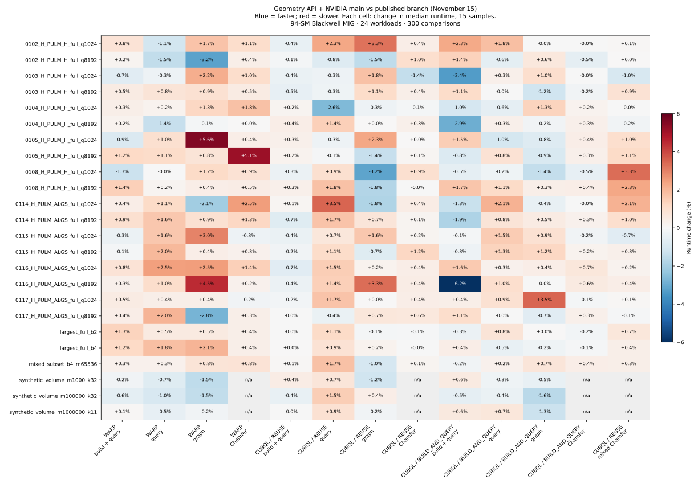

# Geometry API and main-update validation

**November 15, 2026 · [issue #22](https://github.com/alecjacobson/warp/issues/22) · 94-SM Blackwell MIG.** The branch now uses `wp.Bvh` and scalar queries as its kernel interface, with `warp.geometry.PointIndex` and `warp.geometry.knn()` for array operations. It is rebased onto NVIDIA main **`3afdd69addbf0486f4d3d01ba93ee9ee279f4323`**, 83 commits ahead of the fork's main at the time of the update. The [API guide](../public-api.md) documents construction, reuse, updates, capture, gradients, and migration.

**No material performance regression was observed in this suite.** Across 300 matched timing comparisons, phase geometric means changed by **−0.05% to +0.58%** after both the API revision and main update. All 72 workload/configuration pairs retained exactly the same GPU pool allocation sizes. These measurements cover one GPU and the tested shapes; they do not establish performance on other hardware.

## Before/after colored table

[](before-after.svg)

Each cell is **100 × (new median / old median − 1)**. Blue means faster, red means slower, and gray is not applicable (Chamfer is measured only for k=1). Columns use `geometry.PointQueryBackend.WARP`, or `geometry.PointQueryBackend.CUBQL` with the indicated `geometry.PointQueryObjective`. Mixed Chamfer uses `CUBQL`/`REUSE` for fixed targets and `WARP` for the changing decoded targets.

| Phase | Comparisons | Runtime change, new API vs published branch |
| --- | ---: | ---: |
| Build + query | 72 | −0.05% |
| Reused query | 72 | +0.58% |
| Query graph replay | 72 | +0.28% |
| Symmetric Chamfer, same backend | 63 | +0.41% |
| Symmetric Chamfer, mixed backends | 21 | +0.58% |

The largest increase is **5.57%, or 1.52 µs**, for the WARP query graph on `0105_H_PULM_H_full_q1024` (27.28 → 28.80 µs). The post-main engine control is 28.93 µs on that case, so the owner wrapper does not explain the increase. The largest ordinary Chamfer increase is **5.13%, or 56.11 µs**, on `0105_H_PULM_H_full_q8192`; the control comparison and every individual median are retained in [cases.csv](cases.csv). No case exceeds 6% slowdown. Small timing differences in separate sequential runs are not statistical guarantees.

A targeted follow-up repeats both cases in three alternating-order rounds with 31 samples per timing, preserving the exact query-generation RNG sequence. The Chamfer increase does **not** persist: new-API medians are 1.092–1.099 ms versus the original 1.093 ms; controls are 1.096–1.102 ms. The small graph shift remains around 29 µs in both API and control runs. This isolates it from the owner wrapper but does not identify its precise cause. [Follow-up samples](investigation.json), [script](investigate.py), and [log](investigation.log.gz) preserve that investigation.

The post-main control calls the retained query engine directly, excluding the owner wrapper and deprecated entry-point warnings. Against that control, geometry API phase averages add **0.28–0.48%** for ordinary calls; graph replay changes by **−0.05%**. The measured algorithms and native query paths are retained. See [the full aggregate table](tables.md) for all three comparisons and median absolute changes.

## Public API decisions

- Keep `wp.Bvh(points, points)`, `wp.point_query_nearest()`, and `wp.point_query_knn()` / `while wp.point_query_next(...)` as the kernel foundation. Points are zero-volume AABBs in the existing BVH infrastructure.
- Put array construction and queries in the explicitly imported `warp.geometry` module. `PointIndex(targets, ...)` builds fixed targets without allocating neighbor outputs; `knn(owner, queries, k)` reuses them. Passing an array constructs an owner.
- Always return `(PointIndex, indices, distances, counts)` from the geometry API, for single clouds and batches. Keep the owner alive through asynchronous queries and graph replay.
- Expose ordinary Warp BVHs through `owner.bvhs` for caller kernels. Native cuBQL handles remain private and incompatible with scalar Warp BVH queries. Preserve the optimized native route rather than forcing it through a different traversal.
- Preserve the earlier top-level signatures and raw index/tuple returns with deprecation warnings. They remain compatibility entry points; their warning overhead is not part of the recommended geometry API measurements.

## Method and provenance

Three complete runs each contain **24 workloads, 300 timing records, and 15 samples per median** after two warmups. They use the same deterministic inputs, archive, seed, GPU, pool threshold, timer, variants, and output contracts:

1. **Before:** published branch `60c4da49fe101233663578334094f789b27bc1c3`, original `benchmark_point_query_batched.py`, original native binary. [Raw samples](before.json), [log](before.log.gz).
2. **After:** the new geometry API on the rebased branch, using `benchmark_point_query_api_revision.py --api geometry`. [Raw samples](after.json), [log](after.log.gz).
3. **Engine control:** the same rebased code and native binary, invoking the retained engine through the original benchmark body with deprecated namespace lookups removed. [Raw samples](engine.json), [log](engine.log.gz).

The rebase rewrote 26 branch commits without conflicts. Native source changes from main required a fresh [native build](build.log.gz) with `--quick --cuda-path /home/horde/cuda/12.9.1 --jobs 4`; no native kNN algorithm changes were made for this API revision. Run-time source/binary hashes are embedded in each JSON; [provenance.json](provenance.json) records the base commits, build, and final source hashes. The deprecated shim's function metadata was corrected after the geometry run; that shim is outside both measured post-change paths.

The suite includes full pulmonary clouds with 1,024/8,192 queries, largest-cloud B=2/B=4, a mixed B=4 subset, and three synthetic volume cases with k=11/32. Outputs use int32 IDs and squared float32 distances. The synchronized wall timer includes Python submission, allocation, previous-result retirement, and synchronization; it excludes upload, compilation, warmup, and graph capture. Graph samples contain one replay. Chamfer includes both directions and backward, reusing fixed-target indexes while constructing decoded indexes each step.

Query checks compare sampled neighbors against exhaustive reference distances. Captured queries are checked again after changing query coordinates. Benchmark Chamfer checks verify finite loss/gradients and agreement between same-backend and mixed-backend losses. Complete gradient correctness is covered separately by the unit suite, including exhaustive references and finite differences. Retained GPU memory excludes inputs, transient construction scratch, and training peak usage; equal retained allocations are not a peak-memory claim.

The [external-library colored tables](../comparisons.md) retain their November 13 evidence, dependency pins, and contracts. Those libraries were not rerun or modified for this API revision, and their timings are not pooled with this experiment.

## Validation

- **86 focused CPU/CUDA tests passed:** scalar queries, legacy arrays, new owners, BVHs, construction without queries, reuse without rebuild, output validation, empty batches, explicit native dispatch, refit/rebuild, capture, and gradients in both Chamfer directions. [Log](focused-tests.log.gz).
- **10 benchmark-harness/oracle tests passed**, including full-gradient reference validation. [Log](harness-tests.log.gz).
- **16 owner tests passed again** after strengthening compatibility warning/signature checks. This is a subset of the 86 tests, not an additional distinct count. [Log](owner-tests-final.log.gz).
- Scalar/fused examples pass on CPU and CUDA. Chamfer optimization decreases loss on CPU, CUDA WARP/WARP, and CUDA CUBQL/WARP. [Example logs](examples.log.gz), [public scalar snippet log](public-snippet.log.gz).
- Strict HTML documentation build and changed-file pre-commit checks pass. [Documentation log](docs-final.log.gz), [pre-commit log](pre-commit-final.log.gz). Documentation doctests were not run; the public scalar snippet and executable examples were checked separately.

## Reproduce

Use the recorded original commit for the before run and build its native library from that source. For the after/control runs, build the current branch. Keep each run sequential on the GPU. The supplied pulmonary archive is not committed. Preserve optional benchmark dependencies by using `--no-sync` in the existing environment.

```bash
# On the original commit, before the rebase/API change:
uv run --no-sync -m warp.examples.benchmarks.benchmark_point_query_batched \
  --archive pulmonary_point_clouds.zip --output before.json --repeats 15

# On the revised branch:
uv run --no-sync -m warp.examples.benchmarks.benchmark_point_query_api_revision \
  --archive pulmonary_point_clouds.zip --output after.json --repeats 15 --api geometry
uv run --no-sync -m warp.examples.benchmarks.benchmark_point_query_api_revision \
  --archive pulmonary_point_clouds.zip --output engine.json --repeats 15 --api engine

# With those JSON files saved in this report directory:
uv run --no-sync python reports/knn/api-revision/summarize.py
# Optional targeted follow-up; run sequentially with the other benchmarks:
PYTHONPATH=. uv run --no-sync python reports/knn/api-revision/investigate.py
uv run --no-sync -m unittest \
  warp.tests.geometry.test_point_query_batched warp.tests.geometry.test_point_query_batch \
  warp.tests.geometry.test_point_query warp.tests.geometry.test_bvh \
  warp.examples.benchmarks.test_point_query_comparison warp.examples.benchmarks.test_point_query_training
uv run --no-sync build_docs.py --no-doctest --warnings-as-errors
```

The backup branch `alecjacobson/knn-before-api-20261115` preserves the original local branch tip. Broader hardware tuning, peak training-memory measurement, fused launches across batches, ragged batches, and application encoder integration remain outside this API revision.
