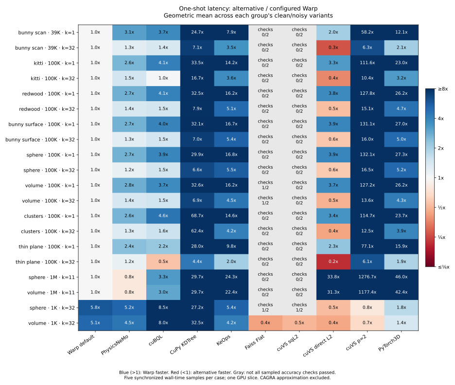

# Broader GPU kNN comparison

**Historical snapshot.** Measurements, API names, and status below describe the recorded implementation and hardware. Use the [current comparisons](../../comparisons.md) for this branch. Archived reproduction commands assume their original checkout and paths.

**Fresh full-library rerun:** [November 12 comparison](../refresh/README.md) measures the improved implementation against all 11 exact configurations, including reused-index search.

**Follow-up:** [The Warp/PhysicsNeMo investigation](../hybrid/README.md) improves point-tree geometry and query scheduling, reruns cuVS, and adds 56 holdouts plus an equally tuned PhysicsNeMo variant. The measurements on this page preserve the original comparison before those changes.

This extends the PhysicsNeMo-only comparison with CuPy GPU KD-tree, KeOps, Faiss GPU Flat, cuVS brute force, PyTorch3D, and cuVS CAGRA. CAGRA is approximate and is scored separately. The experiment measures 3D float32 point queries; it does not claim to characterize high-dimensional vector search.

[Reproduce](reproduce.md) · [Dataset manifest](manifest.json) · [Per-case CSV](cases.csv) · [Full JSON and logs](results/) · [Summary](summary.json)

## Findings

**Configured Warp is fastest among the exact alternatives in 16/40 one-shot cases and 11/40 reused-index query cases.** The one-shot count is 16/40 both with and without excluding failed accuracy checks. These are comparisons of five-sample medians on one GPU slice, not statistical significance claims. The earlier 42/42 result against PhysicsNeMo on a different matrix is not a broad performance guarantee.

| Regime | Cases | Warp fastest one-shot | Strongest competing result |
| --- | ---: | ---: | --- |
| N=39K/100K, Q=1,024, k=1 | 16 | 16 | Warp leads across clean/noisy scans and synthetic families |
| N=39K/100K, Q=1,024, k=32 | 16 | 0 | Direct-L2 cuVS is 1.5–5.7x faster and passes all checks |
| N=1M, Q=8,192, k=11 | 4 | 0 | PhysicsNeMo is 1.21–1.28x faster |
| N=1K, Q=32, k=32 | 4 | 0 | Direct-L2 cuVS / Faiss are about 1.9–2.4x faster |

The new priority is the k=32 query regime, especially thin planes and noisy scans. Improving only the BVH builder will not resolve those query-time losses. The existing implementation remains useful and competitive, but these results do **not** justify a claim that it generally beats GPU kNN alternatives.

All 12 configurations completed all 40 cases: **480 measured configuration/case pairs**. Warp, PhysicsNeMo, cuBQL, CuPy KDTree, KeOps, PyTorch3D, direct-L2 cuVS, and Minkowski cuVS pass every sampled correctness check. Faiss and default expanded-L2 cuVS have numerical failures described below. No native Warp algorithm was changed for this comparison.

### One-shot latency, all timed cases

Ratio is alternative latency divided by configured Warp latency; values above one favor Warp. This table retains timings with accuracy failures. It must be read together with the final column.

| Method | Warp faster / timed cases | Geomean other / Warp | Cases passing sampled checks |
| --- | ---: | ---: | ---: |
| warp_default | 21/40 | 1.18x | 40/40 |
| physicsnemo | 36/40 | 1.89x | 40/40 |
| cubql | 37/40 | 2.56x | 40/40 |
| cupy_kdtree | 40/40 | 19.98x | 40/40 |
| keops | 40/40 | 7.97x | 40/40 |
| faiss_flat | 32/40 | 4.69x | 5/40 |
| cuvs_brute_force | 20/40 | 1.68x | 3/40 |
| cuvs_unexpanded | 20/40 | 1.47x | 40/40 |
| cuvs_minkowski | 36/40 | 33.70x | 40/40 |
| pytorch3d | 40/40 | 8.74x | 40/40 |

Default and configured Warp use identical policies in 32 cases; small differences there reflect separate runs. The configured policy changes only the four million-point and four tiny cases. Geometric means weight the chosen cases equally; they do not predict total application runtime.

### Accuracy-filtered comparisons and graph checks

Here a case is comparable only when both methods pass the sampled checks. Different rows can therefore cover different subsets; do not rank their geometric means as if the subsets were identical. “Query graph pass” means capture and changed-query replay passed the separate small probe, not that all 40 cases were captured.

| Method | Completed | Pass sampled checks | Min recall | Warp wins / comparable | Geomean other / Warp | Query graph |
| --- | ---: | ---: | ---: | ---: | ---: | --- |
| warp_default | 40 | 40 | 1.00000 | 21/40 | 1.18x | pass |
| physicsnemo | 40 | 40 | 1.00000 | 36/40 | 1.89x | pass |
| cubql | 40 | 40 | 1.00000 | 37/40 | 2.56x | pass |
| cupy_kdtree | 40 | 40 | 1.00000 | 40/40 | 19.98x | failed/unsupported |
| keops | 40 | 40 | 1.00000 | 40/40 | 7.97x | failed/unsupported |
| faiss_flat | 40 | 5 | 0.84375 | 2/5 | 1.23x | pass |
| cuvs_brute_force | 40 | 3 | 0.00284 | 0/3 | 0.54x | pass |
| cuvs_unexpanded | 40 | 40 | 1.00000 | 20/40 | 1.47x | pass |
| cuvs_minkowski | 40 | 40 | 1.00000 | 36/40 | 33.70x | pass |
| pytorch3d | 40 | 40 | 1.00000 | 40/40 | 8.74x | pass |
| cuvs_cagra | 40 | 38 | 0.93750 | ANN; separate | — | pass |

### Reused index

Construction is excluded for methods with an explicit reusable index. For PhysicsNeMo, KeOps, and PyTorch3D, the public operator remains the measured call because this adapter exposes no separate index. All pairwise ratios below use passing cases. The [per-case data](cases.csv) also includes construction and supplemental CUDA-event times.

| Method | Warp query wins / comparable | Geomean other / Warp |
| --- | ---: | ---: |
| warp_default | 18/40 | 1.19x |
| physicsnemo | 40/40 | 2.82x |
| cubql | 27/40 | 1.21x |
| cupy_kdtree | 40/40 | 13.79x |
| keops | 40/40 | 11.92x |
| faiss_flat | 2/5 | 1.24x |
| cuvs_brute_force | 0/3 | 0.62x |
| cuvs_unexpanded | 20/40 | 2.18x |
| cuvs_minkowski | 37/40 | 50.13x |
| pytorch3d | 40/40 | 13.07x |

Direct cuBQL wins 13/40 query comparisons against configured Warp, even though Warp wins 37/40 one-shot comparisons against it. The [fastest-alternative comparison](best-reused_index_search.json) makes these query/build tradeoffs visible; one near tie differs by less than 1%, so counts should not be interpreted as robust wins at that margin.

### Approximate CAGRA

CAGRA's sampled recall ranges from **93.75% to 100%**; the two failing exact-rank cases are the clean Redwood fragment at k=1 and k=32. Its reused query is faster than Warp in 16/40 cases, but one-shot calls are slower in all 40. Build medians range from roughly 12 ms to 9.1 s. At one million points, query medians are about 4.1–4.4 ms and sampled recall is 100%.

For the 16 faster-query cases, a simple build-plus-repeated-query cost model needs approximately 114–677 batches to offset CAGRA's additional construction cost relative to Warp. This is an estimate from these timings, not a matched-recall or application benchmark. CAGRA is excluded from exact-method winner counts.

### Validation and provenance

Eight benchmark-specific oracle/data-generation tests pass, and formatting/generated-file checks pass. Each timed case verifies its input file hash and records accuracy, all timing samples, output contract, and a memory snapshot. [Raw results](results/) retain library versions, native source hash, benchmark source hashes, pinned external revisions, process outcomes, graph errors, and allocator policies.

The first eleven configurations were measured from benchmark commit `d97f7d9`; direct-L2 cuVS was added and measured at `12e7934`. The PhysicsNeMo graph probe was rerun after removing an unnecessary external capture registration from the harness; its own stream bridge captures successfully. Normal timing results were unchanged. The [initial adapter failure](setup/physicsnemo-graph-adapter-failure.log) is retained for provenance. Log trailing whitespace and line endings are normalized for Git. Both Warp configurations, PhysicsNeMo, cuBQL, Faiss, all three cuVS metrics, PyTorch3D, and CAGRA pass the graph probe. CuPy and KeOps fail for the public-path limitations described below.

## Why these alternatives

| Implementation | Role in this comparison | Index lifetime |
| --- | --- | --- |
| Warp default / configured | Exact 3D BVH traversal; existing native implementation | Explicit reusable BVH |
| [PhysicsNeMo PR 2112](https://github.com/NVIDIA/physicsnemo/pull/2112) | Original target, pinned source; Warp-based tree and query | Public adapter builds inside each call |
| [cuBQL](https://github.com/ingowald/cuBQL) | Direct native BVH baseline from the original experiment | Explicit reusable BVH |
| [CuPy KDTree](https://docs.cupy.dev/en/stable/reference/generated/cupyx.scipy.spatial.KDTree.html) | Exact GPU spatial tree, `eps=0`, leaf size 16 | Explicit reusable tree |
| [KeOps](https://kernel-operations.io/keops/_auto_benchmarks/benchmark_KNN.html) | Exhaustive symbolic squared-distance reduction, `Kmin_argKmin` | No separate index |
| [Faiss GPU Flat](https://github.com/facebookresearch/faiss/wiki/Faiss-on-the-GPU) | Exhaustive GPU L2 baseline, float32, 256 MiB temporary resource | Explicit flat index; includes `.add()` |
| [cuVS brute force](https://docs.nvidia.com/cuvs/api-reference/python-api-neighbors-brute-force) | Exhaustive search with default expanded squared L2, direct unexpanded L2, and Minkowski p=2 | Explicit flat index |
| [PyTorch3D kNN](https://pytorch3d.readthedocs.io/en/latest/modules/ops.html) | Point-cloud-oriented exhaustive GPU operator | No separate index |
| [cuVS CAGRA](https://docs.nvidia.com/cuvs/api-reference/python-api-neighbors-cagra) | Approximate graph search; recall and index amortization matter | Explicit graph index |

CAGRA uses NN-descent construction, intermediate degree 64, graph degree 32, and search `itopk_size=64`; other search parameters use library defaults. This is one reasonable configuration, not a recall/latency tuning frontier. Faiss IVF/PQ and other approximate families are deferred: their training, compression, and recall tradeoffs need a separate study. CPU trees and high-dimensional ANN datasets would answer different questions.

## Dataset coverage

| Family | Provenance / construction | Pilot size |
| --- | --- | --- |
| Bunny scan | Original Stanford `bun000.ply` range-scan vertices | 39,232 reference + 1,024 held-out query rows |
| KITTI LiDAR | Drive 2011_09_26_0002, first synchronized Velodyne frame, XYZ only | 100,000 + 1,024 held-out rows |
| Redwood RGB-D | Open3D `cloud_bin_0.pcd`; preprocessed fragment, not raw depth frames | 100,000 + 1,024 held-out rows |
| Bunny surface | Independent area-uniform samples of reconstructed triangle mesh | N=100,000, Q=1,024 |
| Sphere surface | Independent uniform directions | N=100,000, Q=1,024 |
| Volume | Independent uniform cube samples | N=100,000, Q=1,024 |
| Clusters | Eight Gaussian clusters plus 2% uniform outliers | N=100,000, Q=1,024 |
| Thin plane | Uniform XY, Z thickness 0.001 of unscaled cube | N=100,000, Q=1,024 |

Each row has k=1 and k=32, both clean and Gaussian-noisy: 32 cases. Four further sphere/volume cases use N=1,000,000, Q=8,192, k=11, with/without noise. Four tiny cases use N=1,000, Q=32, k=32. Total: **40 cases**.

The [Stanford repository](https://graphics.stanford.edu/data/3Dscanrep/) supplies both original range scans and reconstructed surfaces; these are separate workload families here. [KITTI raw data](https://www.cvlibs.net/datasets/kitti/raw_data.php) supplies an outdoor LiDAR distribution. The [Open3D RGB-D sample](https://www.open3d.org/docs/release/python_api/open3d.data.DemoICPPointClouds.html) preserves continuity with earlier measurements while adding disjoint queries.

Raw scan rows are never upsampled. References and queries use disjoint source rows; duplicate coordinates, if present in a source, remain. Sampled surface/volume queries are independent of references. All data is centered and normalized by its original longest bounding-box edge. Noise is independent on reference/query positions with sigma=0.01 of that edge; the clean/noisy variants start from identical samples. The Gaussian perturbation is a geometric stress test, not a calibrated sensor-noise model. Seeds, source members, transforms, actual sizes, archive hashes, array hashes, and file hashes are saved. KITTI's noncommercial dataset terms remain applicable; source and derived arrays are downloaded/generated locally, not committed.

## Measurement contract

All inputs are contiguous float32 and already on the GPU before timed calls. Host-to-device transfer is measured separately. Every adapter returns CUDA int64 indices and float32 **Euclidean** distances, sorted by distance in original query order. Casts, square roots, output allocation, optional query sorting, padding, and restoration of query order are included. Equal-distance index order may differ by library. No backward/autograd computation is timed.

For indexed methods, record construction, search with a reused index, and a complete build-plus-search call. For operators with no exposed reusable index, record their complete call; do not invent a zero-cost reusable index. One-shot timing includes retiring the prior result/index inside the measurement interval, as in the earlier harness. All methods use the same CUDA stream where their API permits it; device synchronization bounds each sample. The primary metric is **synchronized wall time**, including Python/C++ submission overhead. CUDA-event samples are supplemental. These numbers must not be mixed with the earlier report's event-time headline.

Two warmup calls precede five measured repetitions per phase. Each library runs in a separate process, sequentially; graph probes are also isolated. GPU clocks are not locked, and this is a shared VM, not a dedicated benchmark appliance. No baseline compilation overlaps final timings. Report medians and retain all five samples; small differences deserve repeat experiments. The memory field is a post-warmup snapshot including allocator caches/context, **not peak memory**.

Warp uses a 512 MiB CUDA memory-pool release threshold, as established in the earlier allocator investigation. Torch uses its native caching allocator; CuPy uses its default caching pool; cuVS/RMM uses an async resource with a 512 MiB release threshold. Faiss reserves 256 MiB of scratch. These policies are explicit and are not equal-memory-budget experiments.

The configured Warp policy is frozen from the prior work: leaf 32 plus stride 32/block 32 for Q<=32; leaf 32 plus Morton query sorting for N>=1,000,000 and larger query batches; otherwise leaf 4 and natural query order. Sorting is charged on every query. The default Warp row uses leaf 4 and natural order everywhere. Neither policy was selected separately for each new dataset.

Validation checks all output shapes, index bounds, finite distances, duplicates, and ordering. For 32 evenly spaced query rows per case, an exhaustive float64 oracle checks neighbor distance ranks (rtol=1e-5, squared-distance atol=1e-12), reported distances (rtol=5e-4, atol=1e-6), and tie-aware recall. “Pass” means these sampled checks pass, not that every output has been exhaustively verified. An exhaustive float32 algorithm can differ from float64 on close neighbors; numerical discrepancies are retained rather than silently dropping them. Approximate results remain labeled approximate even when sampled recall is one.

## Integration findings and fair configurations

- The third-party Faiss wheel lacks sm120 kernels (CUDA 209); the official v1.14.1 source was built for this device. PyTorch3D was also built from pinned official source. Build revisions and imported paths are recorded.
- cuVS 26.10's Python integer stream binding returned the Python integer object's address as the CUDA stream in a `cuvsStreamGet` diagnostic. The adapter binds the stream using the public `cuvsStreamSet` C API with an explicit pointer conversion. It does not modify the search algorithm.
- CuPy KDTree 14.2 performs a host scalar read in `if not cupy.isinf(p)` during its public query, which fails graph capture. KeOps 2.3's NVRTC launcher uses stream 0, device allocations and context synchronization internally; its public call also fails capture. These are integration limitations of the tested paths, not claims about all possible kernels in those libraries. Synchronized wall timing includes this work.
- Warp and cuBQL adapters allocate return tensors through Torch and wrap them with Warp without copies. Exporting fresh Warp graph-owned allocations through `wp.to_torch` failed pointer classification during capture; allocating through Torch avoids this interop issue. Native search is unchanged. Torch graph capture is registered with Warp using its documented `capture_begin(external=True)` / `capture_end()` protocol.
- cuVS's default Python output allocations use stream 0 and failed capture. The adapter supplies outputs allocated through Torch on the active stream, with allocation cost included. This enables the tested query graph path.
- PyTorch3D's default sorted wrapper reads a GPU scalar in a Python conditional. The adapter requests unsorted kNN and performs `torch.sort`/`gather` on device, including those costs. This enables the tested query graph path.
- CAGRA's 3D row-alignment path launched one kernel per query: profiling recorded 2,048 `search_single_cta` kernels for two 1,024-query calls. The release source explicitly falls back to one query per call when padded stride differs from logical dimension. Appending a zero fourth coordinate preserves Euclidean distances and enables batching; padding both references and queries is included in timing. The unpadded diagnostic was about 270 ms per query batch; this is not used as the competitive baseline. See [cuVS release source](https://github.com/NVIDIA/cuvs/blob/24ee1bf1cb17cad0ac611e39643af39ee1870124/cpp/src/neighbors/detail/cagra/cagra_search.cuh) and [diagnostic profile](setup/cuvs-profile.log).
- The direct-L2 cuVS adapter exposes the documented C API metric `L2Unexpanded=4` by adding a name to the Python `DISTANCE_TYPES` registry, which omits this metric in 26.10. This is an adapter binding, not a change to the native distance or search kernels.
- cuVS's default `sqeuclidean` uses expanded L2. Its scan discrepancies motivate the separate public `minkowski`, p=2 baseline, which returns Euclidean distance directly. This variant avoids assuming that fast nominally exhaustive search meets the same numerical contract.

Graph results test a warmed **query with a prebuilt index** (or the public operator where no index exists), followed by changed query coordinates and three replays. They do not prove that every dataset, full index construction, refit, or backward pass is capturable, and graph replay latency is not the headline benchmark. Capture failures are preserved with their tracebacks.

## Numerical findings

Faiss Flat fails the sampled neighbor-rank check in **5/40** cases and the reported-distance check in **35/40**. Default cuVS expanded L2 fails those checks in **9/40** and **37/40**, respectively. These counts describe the fixed tolerances above; a distance-only failure does not imply that the selected neighbors are wrong. All timings remain available, including these failures.

The clean million-point sphere is a more serious counterexample: default cuVS sampled recall is **0.284%**. Its expanded-distance implementation has an equal-norm clamp that can zero distances between distinct nearby points. A two-reference, one-query [reproducer](probe_precision.py) uses exactly representable float32 coordinates. Their true distances are approximately 0.001381068 and 0.001953125; expanded L2 reports both as zero, while direct L2 and Minkowski p=2 report the correct distances. The [observed output](setup/precision-probe.log) is consistent with the [release's clamp implementation](https://github.com/NVIDIA/cuvs/blob/24ee1bf1cb17cad0ac611e39643af39ee1870124/cpp/src/distance/detail/distance_ops/l2_exp.cuh). This explains why clean constant-radius samples are an important test, even when noisy samples look correct.

The direct-L2 variant uses the [documented native distance enum](https://github.com/NVIDIA/cuvs/blob/24ee1bf1cb17cad0ac611e39643af39ee1870124/c/include/cuvs/distance/distance.h) through a local Python metric-name binding. Its performance is measured separately from the general Minkowski implementation; neither changes cuVS's native kernels.

## Scope and next evidence

This pilot establishes a reproducible comparison across distinct algorithms and data geometries on one GPU slice. It does not establish a universal winner. Before an upstream performance claim, expand query/reference size sweeps, k values, additional scan frames, multiple seeds, independent process repetitions, graph replay timing, transient peak memory, and full-GPU/other-architecture runs. Training, multiple-batch amortization, and matched-recall tuning should be evaluated separately for approximate indices.
