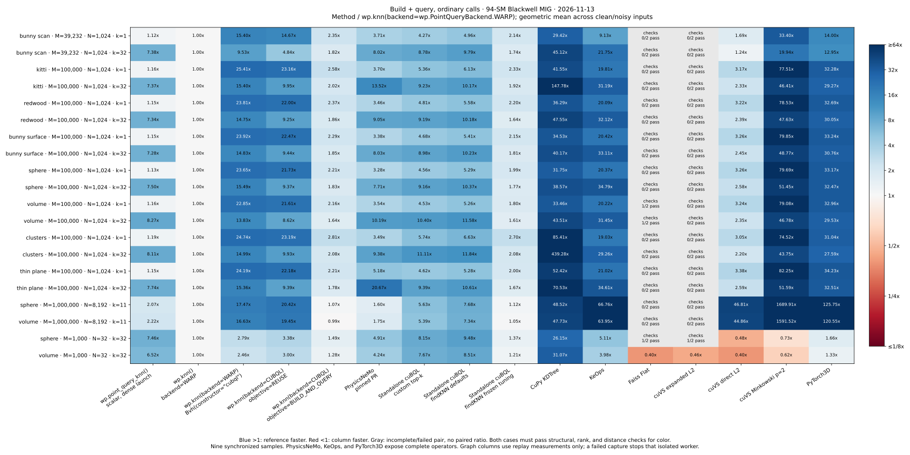
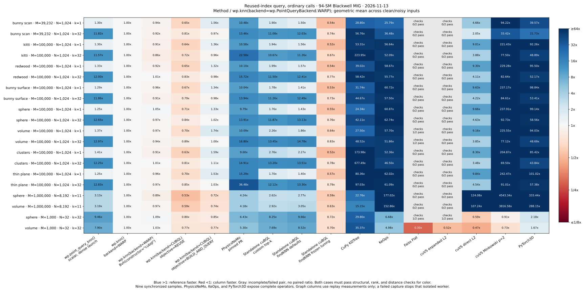
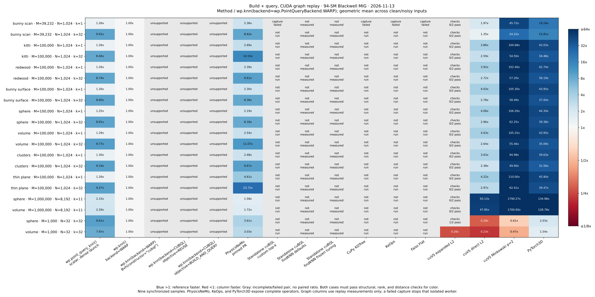
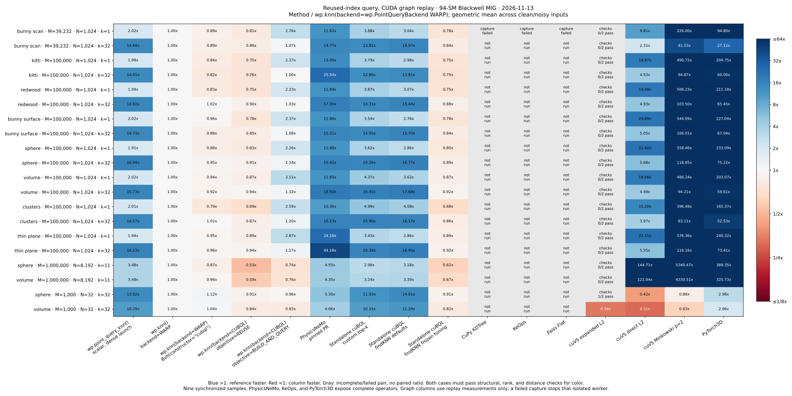
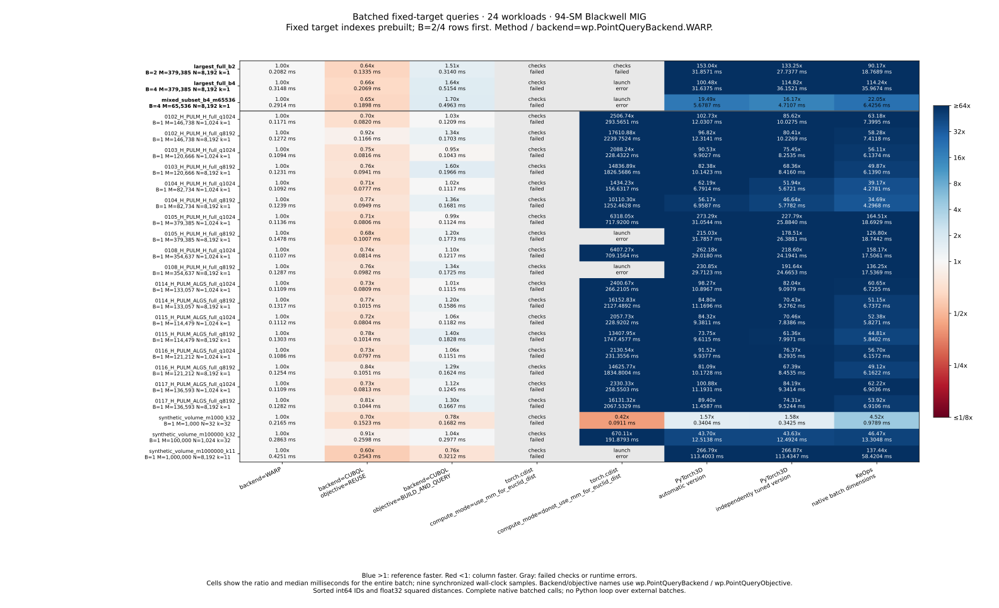
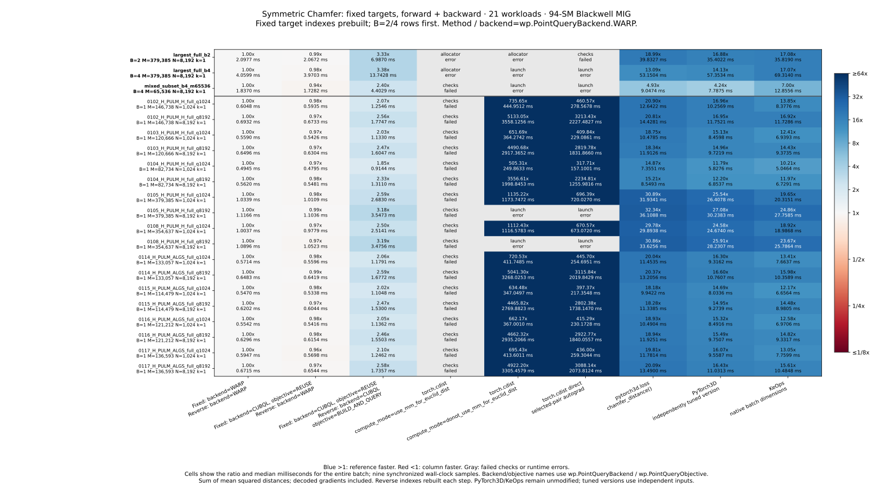
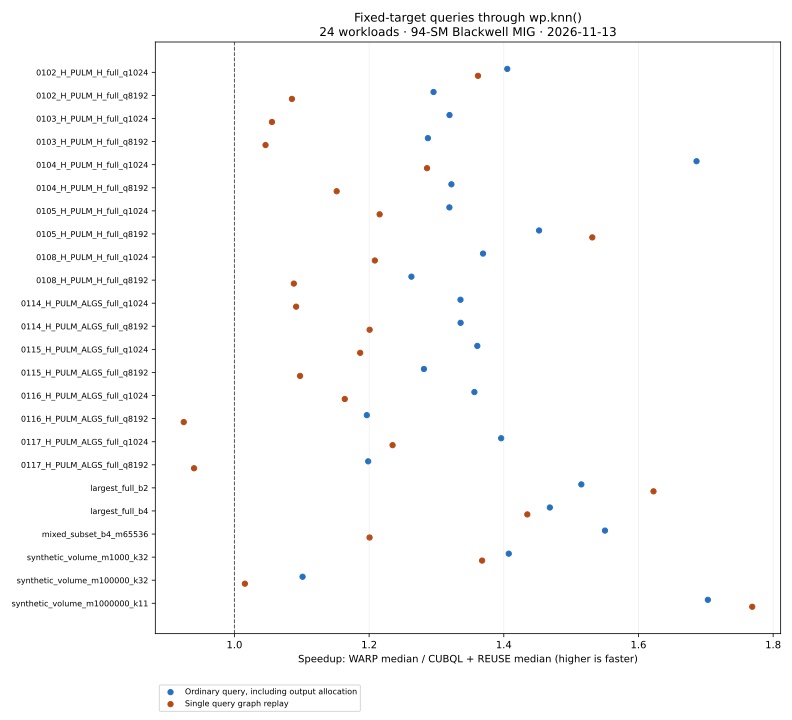

# Current kNN comparisons: colored tables and public settings

**2026-11-13 · `alecjacobson/knn` · 94-SM Blackwell MIG.** Six colored tables cover [single-cloud queries](#colored-cross-library-comparisons) and [batched queries / fixed-target Chamfer](#batched-queries-and-chamfer-against-external-libraries). The first four compare **16 configurations across 40 workloads**. The two new tables compare **eight query configurations across 24 workloads** and **nine Chamfer configurations across 21 workloads**, including native batched PyTorch, PyTorch3D, and KeOps calls. Each experiment has its own fresh timings and matching public Warp reference.

Start with `backend=wp.PointQueryBackend.WARP` when targets change often. For repeated CUDA queries against fixed targets, start with `backend=wp.PointQueryBackend.CUBQL`, `objective=wp.PointQueryObjective.REUSE`. Both use **Warp's public `wp.build_point_index()` and `wp.knn()` APIs**; callers do not need a separate cuBQL Python library. See the [public API guide](public-api.md) for complete examples and contracts.

## Colored cross-library comparisons

Each cell is **column time / `wp.knn(backend=wp.PointQueryBackend.WARP)` time**. **Blue above 1 means the reference is faster; red below 1 means the column is faster.** A row combines a clean/noisy pair by geometric mean only when both pass. Gray cells have failed checks, failed/unsupported capture, or no measurement. `1/2 pass` means one case passed: that individual case can enter the linked case-level aggregates, but the pair gets no colored ratio. Failed or missing measurements never enter rankings. Open an image for its full-size table. [All medians and statuses](current/libraries/cases.csv), [aggregate tables](current/libraries/tables.md), [raw results and provenance](current/libraries/provenance.json), and [reproduction instructions](current/libraries/reproduce.md) are available.

### Build + query, ordinary calls

[](current/libraries/one-shot.svg)

`backend=wp.PointQueryBackend.WARP` has the lowest construction-plus-query median among the five public choices in **38/40** cases, and among all passing configurations in **34/40**. `backend=wp.PointQueryBackend.CUBQL`, `objective=wp.PointQueryObjective.BUILD_AND_QUERY` wins the other two public comparisons. External brute-force methods win four of the overall comparisons on the tiny workloads.

### Reused-index query, ordinary calls

[](current/libraries/reused-query.svg)

`backend=wp.PointQueryBackend.CUBQL`, `objective=wp.PointQueryObjective.REUSE` beats `backend=wp.PointQueryBackend.WARP` in **40/40**, averaging **1.38×** faster. Standalone cuBQL with frozen tuning is faster still in ordinary calls; its column omits Warp's public wrapper. PhysicsNeMo, KeOps, and PyTorch3D expose complete operators, so their columns still include the entire operation rather than pretending to reuse an index.

### Build + query, CUDA graph replay

[](current/libraries/graph-one-shot.svg)

`backend=wp.PointQueryBackend.WARP` has the lowest passing graph median in **36/40** cases; cuVS direct L2 wins the four tiny cases. PhysicsNeMo, cuVS direct L2/Minkowski, and PyTorch3D complete all 40 construction-inclusive capture checks; expanded L2 captures but retains its numerical failures.

### Reused-index query, CUDA graph replay

[](current/libraries/graph-reused-query.svg)

For prebuilt target indexes, `backend=wp.PointQueryBackend.CUBQL`, `objective=wp.PointQueryObjective.REUSE` beats `backend=wp.PointQueryBackend.WARP` in **40/40**, averaging **1.24×** faster. Construction capture is supported by `backend=wp.PointQueryBackend.WARP`; the direct cuBQL routes require construction outside capture. Every colored graph cell passed checks using both original and changed inputs.

The public `objective=wp.PointQueryObjective.REUSE` graph route and standalone frozen-tuned cuBQL are effectively tied in geometric mean in this run. The `backend=wp.PointQueryBackend.WARP`, `bvh=wp.Bvh(..., constructor="cubql")` control has the lowest passing query-graph median in **4/40** cases, but carries expensive construction. These workload-specific wins are a reason to preserve the explicit alternatives and measure the caller's workload.

### What each column measures

| Column | Actual public call or external configuration |
| --- | --- |
| Scalar kernel | `wp.Bvh(points, points)` with its default leaf size; `wp.point_query_knn()` in a dense launch. |
| `wp.knn()`, `backend=WARP` | `backend=wp.PointQueryBackend.WARP`, automatic policy. This is the reference column. |
| `wp.knn()`, `Bvh(constructor="cubql")` | `backend=wp.PointQueryBackend.WARP`, supplied `bvh=wp.Bvh(..., constructor="cubql", leaf_size=config.leaf_size)`; `config=wp.point_query_config(...)`. |
| `wp.knn()`, `objective=REUSE` | `backend=wp.PointQueryBackend.CUBQL`, `objective=wp.PointQueryObjective.REUSE`. |
| `wp.knn()`, `objective=BUILD_AND_QUERY` | `backend=wp.PointQueryBackend.CUBQL`, `objective=wp.PointQueryObjective.BUILD_AND_QUERY`. |
| Standalone cuBQL, custom top-k | Earlier benchmark adapter with its own exact top-k traversal. |
| Standalone cuBQL, defaults / frozen tuning | Unmodified `cuBQL::points::findKNN`, either defaults or the previously selected regime policy. Separate policies optimize construction-inclusive and reused-query timing. |
| PhysicsNeMo | Pinned kNN implementation from the earlier PR, with import adaptation recorded by the benchmark. |
| CuPy / KeOps / Faiss / PyTorch3D | `KDTree`, `Kmin_argKmin`, `GpuIndexFlatL2`, and `knn_points`, respectively. |
| cuVS, three columns | Brute force with expanded squared L2, direct squared L2, or Minkowski p=2. The direct metric uses the existing benchmark's C-API enum binding. |

The standalone and external columns are benchmark controls; they are not additional `wp.knn()` settings. Full version pins and build choices are in the [reproduction guide](current/libraries/reproduce.md). The frozen cuBQL policy was trained independently on the earlier 46-SM slice. Only its settings were reused; none of that slice's timing samples enter these tables.

### Method and interpretation

- **Inputs:** 40 single-cloud workloads from eight families: original Stanford bunny scan, KITTI, Redwood, sampled bunny surface, sphere, volume, clusters, and thin plane. The suite includes roughly 39k–100k targets with 1,024 queries and k=1/32, million-target cases with 8,192 queries and k=11, and tiny 1,000-target cases with 32 queries and k=32. Clean/noisy pairs form the 20 displayed rows. All coordinate hashes match the preserved historical matrix; the measurements are new.
- **Output contract:** sorted GPU-resident int64 neighbor IDs and float32 Euclidean distances. Required conversion, allocation, and prior result retirement are included in ordinary calls. Uploads, compilation, capture, and warmup are excluded. Query graphs reuse output storage; construction graphs include the captured construction work.
- **Timer:** median of nine samples after warmup, using the same Torch-event/synchronized-wall timer and a Warp-owned blocking stream borrowed by other providers. Graph samples contain one replay. The charts use wall time, including event recording, Python submission, and synchronization; raw GPU-event samples are retained. Each provider runs sequentially in its own process. Warp/RMM async pools retain 512 MiB; Torch/CuPy use their caching allocators. Small wins can reflect noise or allocation differences.
- **Accuracy:** structural checks cover the full outputs; 32 query rows per workload are checked against exhaustive float64 distances. Neighbor-rank checks use squared-distance `rtol=1e-5`, `atol=1e-12`; returned Euclidean distances use `rtol=5e-4`, `atol=1e-6`. Equal-distance IDs are interchangeable. These are sampled, tolerance-based checks, not a proof for every output.
- **Numerical failures:** ordinary Faiss Flat passes **5/40**, and cuVS expanded L2 passes **3/40**, under those checks. Failed rows remain visible but do not enter aggregates. These are exact-search algorithms with finite-precision distance/ranking failures in this experiment. The other 14 configurations pass all 40 ordinary cases. Do not compare an aggregate over three or five passing cases with a 40-case aggregate as though they used the same workload mix.
- **Graph failures:** each external provider/phase has an isolated capture worker. A failed capture stops that worker; subsequent cases are labeled `not run`, not assigned ordinary-call timings. CuPy's adapter attempted a device-to-host transfer; KeOps attempted an incompatible synchronous transfer; Faiss exceeded its configured 256 MiB scratch pool and attempted `cudaMalloc`; standalone custom cuBQL construction synchronized a captured event. This reports the measured adapter and environment, not a universal claim that a library cannot support graphs. Standalone `findKNN` construction graphs were not measured.
- **Builds and hardware:** 94-SM RTX PRO 6000 Blackwell MIG 2g.48gb, CUDA toolkit 12.9.1. The branch's existing quick-build Warp library is unchanged; its native cuBQL path uses `compute_75` PTX. Standalone cuBQL, Faiss, and PyTorch3D were built for `sm_120`. Use the separate [matched-build integration experiment](completion/README.md) to isolate wrapper overhead from that target difference. No other GPU job was launched by this agent during timing.

## Batched queries and Chamfer against external libraries

These tables measure the pulmonary use case through public APIs, including **B=2 and B=4 native batches**. The three multi-batch rows appear first; the remaining rows retain an explicit B=1 dimension. Each cell shows **column time / `backend=wp.PointQueryBackend.WARP` time**, followed by the median milliseconds for the **entire batch**. Blue favors the reference; red favors the column; gray marks failed correctness checks or runtime errors. These are ordinary calls, with fixed target indexes prebuilt where the API supports them.

### Batched queries with precomputed target indexes

[](current/training/query.svg)

`backend=wp.PointQueryBackend.CUBQL`, `objective=wp.PointQueryObjective.REUSE` wins all **24/24** comparisons against `backend=wp.PointQueryBackend.WARP`, averaging **1.36×** faster. All three public configurations, both PyTorch3D configurations, and KeOps pass every query case. Outputs are sorted int64 IDs and float32 squared distances. PyTorch3D and KeOps perform their complete batched query operation on every call; they expose no reusable target index in the measured APIs.

### Symmetric Chamfer with fixed targets, including backward

[](current/training/chamfer.svg)

Every step queries both directions, reduces the sum of mean squared distances, and computes gradients with respect to decoded points. The fixed target index is reused; the reverse index on decoded points is constructed each step. The mixed choice—fixed `backend=wp.PointQueryBackend.CUBQL`, `objective=wp.PointQueryObjective.REUSE`, reverse `backend=wp.PointQueryBackend.WARP`—wins **21/21** comparisons against the default backend both ways, averaging **1.03×** faster. All three public configurations, both PyTorch3D configurations, and KeOps pass the full loss/gradient checks.

For **B=4, M=379,385, N=8,192, k=1**, the new matched comparison is:

| Public configuration | Fixed-target query (ms) | Symmetric Chamfer + backward (ms) |
| --- | ---: | ---: |
| `backend=wp.PointQueryBackend.WARP`; same backend for reverse | 0.31485 | 4.05993 |
| `backend=wp.PointQueryBackend.CUBQL`, `objective=wp.PointQueryObjective.REUSE`; reverse `backend=wp.PointQueryBackend.WARP` | **0.20688** | **3.97031** |
| PyTorch3D automatic `knn_points()` / native `chamfer_distance()` | 31.63746 | 53.15038 |
| PyTorch3D `knn_points(version=...)`, independently tuned per direction | 36.15212 | 57.35345 |
| KeOps batched `LazyTensor` reductions; selected-pair autograd | 35.96743 | 69.31399 |

Independent tuning improves PyTorch3D's geometric-mean query and Chamfer times over the full suites, but its automatic setting wins this dense example. Both remain visible. These are workload-specific results on one GPU, not a universal ordering of libraries.

### External settings, failures, and comparison limits

- **PyTorch:** test both documented `torch.cdist` compute modes, with TF32 disabled. The matrix-multiplication mode is also the default algorithm for these sizes. For Chamfer, also test direct search under `torch.no_grad()` followed by gathers and squared-distance autograd, avoiding the dense `cdist` backward graph. These are compositions of unchanged public operators.
- **PyTorch3D:** keep stock `knn_points(version=-1)` and native `chamfer_distance()` as columns. A second configuration selects among all supported D=3 public kernel versions on independent synthetic inputs, separately by batch size, query-count regime, k, and direction. The [tuning record](current/training/tuning.json) contains every candidate. This is the best tested setting in that search; it does not select the fastest version retrospectively on evaluation data.
- **KeOps:** use native batch dimensions for `Kmin_argKmin` queries and bidirectional `argmin` plus selected-pair autograd for Chamfer. External calls process B directly, without a Python loop over clouds or flattening across batch boundaries.
- **Correctness:** PyTorch's matrix-multiplication mode fails the query checks on all 24 cases. Its completed Chamfer calls fail gradient checks even where the scalar loss is close. Those timings are retained but never ranked. Direct mode also encounters launch limits at large pair counts, and its completed B=2 dense query fails checks. Some dense Chamfer calls fail inside PyTorch's NVML allocation-error diagnostics. Gray cells distinguish `checks_failed`, `launch_error`, and `allocator_nvml_error`; the [CSV](current/training/cases.csv) and raw logs retain exact outcomes. These findings apply to the pinned **Torch 2.7.1+cu128** environment.
- **Timing:** nine synchronized wall-clock samples after two warmups, sequential provider processes, common CUDA stream. Uploads, compilation, and fixed-index construction are excluded. Allocation, previous-result retirement, changing reverse-index construction, loss reduction, gradient reset, and backward are included where applicable. Warp uses its native Tape; external libraries use PyTorch autograd. No Torch-to-Warp autograd bridge or full neural-network training step is timed.
- **Validation and scope:** sampled exhaustive float64 neighbor checks plus complete decoded-gradient comparisons against an independent NumPy oracle. The oracle passes finite-difference and batch-isolation tests. PyTorch3D and KeOps sources are unchanged; supported public settings and normal operator composition provide the tuning. Peak training memory and graph replay are not measured in these two tables. The [retained public-only experiment](#separate-pulmonary-and-batched-measurements) supplies separate construction, query-graph, and live-allocation evidence.

Inspect [all medians/statuses](current/training/cases.csv), [aggregate tables](current/training/tables.md), [raw results and provenance](current/training/provenance.json), and [reproduction instructions with API/source references](current/training/reproduce.md). Keep these timings separate from the earlier int32 pulmonary and int64 Euclidean single-cloud experiments.

## Which settings should I use?

| Workload or requirement | Public arguments | Current evidence or contract |
| --- | --- | --- |
| Construct an index and query it once | `backend=wp.PointQueryBackend.WARP` | Lowest construction-plus-query median among public choices in **38/40** cross-library cases and **23/24** pulmonary/batched cases. |
| Repeated queries against fixed CUDA targets | `backend=wp.PointQueryBackend.CUBQL`, `objective=wp.PointQueryObjective.REUSE` | Faster ordinary/query-graph calls in **40/40** cross-library cases, averaging **1.38× / 1.24×**; pulmonary/batched results are **24/24 / 22/24**, averaging **1.37× / 1.20×**. Construction must be amortized. |
| Evaluate cheaper cuBQL construction | `backend=wp.PointQueryBackend.CUBQL`, `objective=wp.PointQueryObjective.BUILD_AND_QUERY` | Lowest construction-plus-query median among public choices in **2/40** cross-library cases and **1/24** pulmonary/batched cases. Usually slower reused queries than `objective=wp.PointQueryObjective.REUSE`. |
| CPU, finite cutoff, self-exclusion, original-index tie ordering, or k > 64 | `backend=wp.PointQueryBackend.WARP` | Supports these requirements. The direct cuBQL route rejects unsupported requests. |
| Capture index construction or refit | `backend=wp.PointQueryBackend.WARP` | Construction/refit capture supported with CUDA memory pools enabled. Both backends support querying prebuilt indexes in graphs. |
| Symmetric Chamfer with fixed targets | Fixed: `backend=wp.PointQueryBackend.CUBQL`, `objective=wp.PointQueryObjective.REUSE`; reverse: `backend=wp.PointQueryBackend.WARP` | Faster forward/backward steps in **21/21** k=1 cases in the new external-library comparison, averaging **1.03×** over `backend=wp.PointQueryBackend.WARP` both ways. |
| Fuse neighbor processing inside your kernel | Build with `backend=wp.PointQueryBackend.WARP`; use `wp.point_query_knn()` and `while wp.point_query_next(...)` | Scalar queries accept `wp.Bvh.id`. Direct `for index in search` iteration is not implemented. |

The backend choice is explicit. `objective` tunes cuBQL; it does not switch backends or change the default implementation's policy. Build the fixed target index once, then pass `bvh=indexes` on subsequent calls. Supplied indexes keep their original settings. Leave `leaf_size`, `query_stride`, and `ordered` automatic initially. The cuBQL route requires CUDA, memory-pool support, and a build with cuBQL enabled; it supports k=1–64.

## Separate pulmonary and batched measurements

This separately measured experiment uses the same completed API and native binary, recorded at [93e506474](https://github.com/alecjacobson/warp/commit/93e506474cdc0e10e57b875a60e986f6f5fbf7f9). Every recorded source/binary hash still matches. It covers **24 workloads**, each with three public configurations, on the same **94-SM slice**. Its outputs are int32 IDs and **squared** distances, and its wall timer does not record Torch events. Keep its timings and geometric means separate from the cross-library tables. [All timings](current/timings.md), [raw samples](current/batched.json), and [aggregates](current/summary.json) are retained.



The chart compares `backend=wp.PointQueryBackend.CUBQL`, `objective=wp.PointQueryObjective.REUSE` against `backend=wp.PointQueryBackend.WARP`; values above 1 favor the former. Query graphs lose on `0116_H_PULM_ALGS_full_q8192` (0.04609 versus 0.04262 ms) and `0117_H_PULM_ALGS_full_q8192` (0.04751 versus 0.04466 ms). These are observed medians, not statistical guarantees of a winner.

### Dense fixed-target example

**B=4, M=379,385, N=8,192, k=1.** Each batch uses the largest original pulmonary target cloud and independently sampled queries. All times are median milliseconds; lower is better.

| Public arguments | Construct + query | Reused ordinary query | Reused query graph |
| --- | ---: | ---: | ---: |
| `backend=wp.PointQueryBackend.WARP` | **1.34463** | 0.30096 | 0.21059 |
| `backend=wp.PointQueryBackend.CUBQL`, `objective=wp.PointQueryObjective.REUSE` | 46.37292 | **0.20496** | **0.14676** |
| `backend=wp.PointQueryBackend.CUBQL`, `objective=wp.PointQueryObjective.BUILD_AND_QUERY` | 2.83211 | 0.51076 | 0.45455 |

Reuse tuning buys query speed with substantially more expensive construction. Compare total time over the expected number of calls, including index retirement and the chosen output-allocation/capture mode. A query-only advantage does not establish a benefit for short-lived indexes.

The construction exception across the full suite is the synthetic M=1,000,000, N=8,192, k=11 case: `backend=wp.PointQueryBackend.CUBQL`, `objective=wp.PointQueryObjective.BUILD_AND_QUERY` takes **0.9313 ms**, versus **0.9535 ms** for `backend=wp.PointQueryBackend.WARP`. This narrow measured win is workload-specific.

### Symmetric Chamfer: measure both directions and backward

For the same dense example, fixed target construction is paid before timing. Every step constructs the reverse index on the changing decoded points, queries both directions, reduces squared distances using the sum-of-means convention, and runs Warp's backward pass.

| Fixed target arguments | Changing reverse target arguments | Forward + backward (ms) |
| --- | --- | ---: |
| `backend=wp.PointQueryBackend.WARP` | `backend=wp.PointQueryBackend.WARP` | 4.05286 |
| `backend=wp.PointQueryBackend.CUBQL`, `objective=wp.PointQueryObjective.REUSE` | `backend=wp.PointQueryBackend.WARP` | **3.96831** |
| `backend=wp.PointQueryBackend.CUBQL`, `objective=wp.PointQueryObjective.REUSE` | `backend=wp.PointQueryBackend.CUBQL`, `objective=wp.PointQueryObjective.BUILD_AND_QUERY` | 13.73926 |

The mixed choice improves this dense step by about **2%**, despite the larger fixed-target query improvement. Across all 21 k=1 workloads it wins 19, with a 1.06× geometric-mean speedup. This measures the Chamfer computation and its gradients, not an encoder, decoder, optimizer, or complete training iteration. The [runnable example](../../warp/examples/geometry/example_point_query_chamfer.py) uses Warp's tape; sharing Torch storage does not automatically connect the two autograd systems.

### Retained memory

For the dense example, live index/output allocations retain **121.94 MiB** with `backend=wp.PointQueryBackend.WARP`, or **98.79 MiB** with `backend=wp.PointQueryBackend.CUBQL`, `objective=wp.PointQueryObjective.REUSE`. Input coordinates add **17.74 MiB** in either case. A float32 B×N×M distance tensor would require **46.31 GiB**.

These are live CUDA-pool bytes retained after construction and query. They exclude inputs from the index/output count and exclude transient construction scratch, tape storage, and peak training memory. The pairwise figure is arithmetic, not a measured `torch.cdist` allocation. For fixed k, index/output storage scales as `O(B*M + B*N*k)`; the API does not materialize a B×N×M tensor.

## Does the public cuBQL route retain standalone speed?

Yes for GPU query graphs, within about **1% in geometric mean** of the matched standalone implementation. Ordinary calls have additional public-wrapper work. The retained [integration comparison](completion/README.md) uses exactly the current recorded source files and native binary; [provenance](current/provenance.json) verifies every saved source/binary hash. It remains applicable and was not rerun for this report cleanup.

| `backend=wp.PointQueryBackend.CUBQL`, `objective=wp.PointQueryObjective.REUSE` | Public time / matched standalone time | Median added time, B=1 |
| --- | ---: | ---: |
| Ordinary query, preallocated outputs | 2.040× | 40.35 µs |
| Ordinary query, output allocation included | 1.724× | 42.01 µs |
| Query graph replay | 1.010× | 0.29 µs |

The raw native preallocated call averages 1.005× standalone time. The public wrapper validates inputs/options, creates batch views, and dispatches each cloud. Capturing the query avoids repeating that Python work. These B=1 measurements retain the leading batch dimension; they do not measure the single-cloud layout's wrapper overhead.

This is a **separate 23-workload experiment** with 31 interleaved samples, int64 indices, Euclidean distances, and 32 replays per graph sample. The retained public-only pulmonary experiment uses int32 indices, squared distances, nine sequential samples, and one replay per graph sample. The new batched cross-library query experiment uses int64 indices and squared distances, with ordinary calls only. Do not pool their timings or geometric means. The integration experiment times queries only, including when `objective=wp.PointQueryObjective.BUILD_AND_QUERY` selects the tree policy.

## Pulmonary methodology and remaining limits

- Hardware: NVIDIA RTX PRO 6000 Blackwell Server Edition MIG 2g.48gb, **94 SMs**, approximately 47.4 GiB available; CUDA 12.9.1 toolkit, driver supporting CUDA 13.2. The existing quick-build native binary was reused. No other test or benchmark job was launched by this agent during the run.
- Inputs: nine supplied original pulmonary clouds with **82,734–379,385** float32 points, original centimeter scale. Each runs with N=1,024 and 8,192. Two cases repeat the largest cloud with B=2/4; one explicitly samples four different clouds to M=65,536 for a non-ragged B=4 batch. Three synthetic `(M,N,k)` cases are `(1000,32,32)`, `(100000,1024,32)`, and `(1000000,8192,11)`. Different-size original clouds are measured separately, with no implicit padding.
- Query generation: seed 20261113, target samples plus independent Gaussian noise of sigma 0.01 in source units. Changed-query graph checks shift coordinates by 0.003.
- Timing: median of nine synchronized wall-clock samples after two warmups, with variants measured sequentially. Construction-plus-query includes previous result/index retirement. Ordinary reuse includes new output allocation and prior output retirement. Graph timing includes one replay and synchronization, using preallocated outputs. Uploads and compilation are excluded. The application retains 512 MiB in the default CUDA pool. Small differences may reflect scheduling, allocation, or run-order effects.
- Fresh numerical checks: all **72 workload/configuration combinations** pass, covering **5,952 sampled rows** against exhaustive reference searches before and after query changes. Tie-aware recall is 1.0; duplicate, ordering, rank, and reported-distance mismatches are zero. Chamfer losses and decoded gradients are finite, and mixed-route losses agree within the harness tolerance. These checks do not exhaustively compare every output or every gradient.
- Retained completion evidence: **89 focused CPU/CUDA tests passed**, including finite-difference gradients and explicit route checks. The recorded source hashes still match. Saved build, strict documentation, and conditional translation-unit checks are in the [completion report](completion/README.md); those compile checks do not establish full alternate-platform runtime support.
- Current scope: fixed-size independent batches, reusable target indexes, both query graph routes, and scalar kernel queries. No ragged batches. Larger-batch fusion, wider hardware tuning, peak training memory, and application integration remain follow-ups.

The [historical archive](archive/README.md) preserves earlier implementations and **46-SM** measurements. Those timings are not included in the current experiments.

## Reproduce and inspect

For the 40-workload colored tables, follow the [cross-library reproduction guide](current/libraries/reproduce.md). It records dependencies, native builds, dataset restoration, worker commands, and presentation generation.

For the new batched query and fixed-target Chamfer tables, follow the [batched cross-library reproduction guide](current/training/reproduce.md), including independent tuning, per-case failure isolation, and gradient checks.

From the repository root, with the supplied dataset and an already built native library matching the source:

```bash
uv run --no-sync -m warp.examples.benchmarks.benchmark_point_query_batched \
  --archive pulmonary_point_clouds.zip \
  --output reports/knn/current/batched.json
uv run --no-sync python reports/knn/current/summarize.py
```

The summarizer needs Matplotlib and regenerates the aggregate JSON, per-case tables, and SVG from saved samples without using the GPU. When taking a new benchmark snapshot, update the report conclusions and provenance as well. Dataset SHA256: `8a16347cc942777083a0c763e049a693af452a2c7bbb07ad7e8511a1457889a4`; the archive remains outside Git.

Evidence: [benchmark source](../../warp/examples/benchmarks/benchmark_point_query_batched.py), [raw results](current/batched.json), [run log](current/benchmark.log.gz), [summary](current/summary.json), [source-hash audit](current/provenance.json), and [standalone reproduction](completion/README.md#reproduce).
