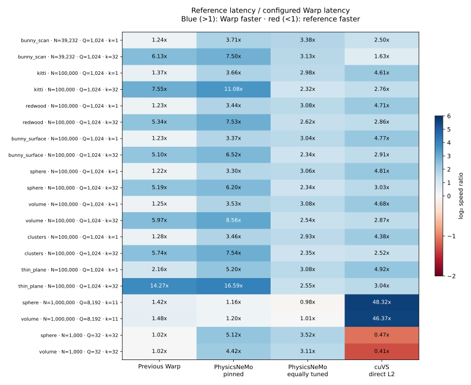

# Comparing Warp and PhysicsNeMo, and improving both

The selected approach keeps Warp's adaptive BVH and bounded heap. Two changes matter most: **preserve Euclidean proportions when computing Morton codes**, and **spread small query batches across warps**. The latter is an explicit caller configuration, not automatic dispatch inside `wp.point_query_knn`.

On the original 40 cases, configured Warp is **2.48× faster than our previous configured implementation** geometrically averaged over one-shot latency. It has lower medians than the pinned PhysicsNeMo PR in **40/40 cases**, including the four million-point losses. The clean thin-plane k=32 case drops from **7.942 to 0.425 ms (18.7×)**.

We applied the same metric and launch improvements to PhysicsNeMo as a separate experimental variant. Against that stronger comparison, Warp has lower medians in **38/40**, but **all four million-point cases are within 5%**: those should be described as near ties. Warp is more than 5% faster in the remaining 36 cases. These are measured medians on one 46-SM Blackwell MIG slice, not significance tests or a universal speed guarantee.

[Reproduce](reproduce.md) · [Per-case CSV](cases.csv) · [Summary JSON](summary.json) · [Pilot inputs](pilot-manifest.json) · [Holdout inputs](holdout-manifest.json) · [Raw results](results/)

## Results and the stronger comparison

All ratios below are **reference latency / configured Warp latency**, so values above one favor Warp. Timings include index construction, query planning, output allocation, host submission, synchronization, and retirement of previous results. Input upload and JIT compilation are excluded. Final runs use nine repetitions after two warmups; the retained before-run uses five.

| Reference | Warp lower median | Reference / Warp geometric mean | Warp >5% faster / within 5% / >5% slower |
| --- | ---: | ---: | ---: |
| Previous configured Warp | 39/40 | 2.48× | 36 / 4 / 0 |
| PhysicsNeMo pinned | 40/40 | 4.70× | 40 / 0 / 0 |
| PhysicsNeMo + isotropic Morton coordinates | 40/40 | 4.23× | 40 / 0 / 0 |
| PhysicsNeMo + isotropic coordinates + sparse launches | 38/40 | 2.55× | 36 / 4 / 0 |
| Current Warp with dense default launches and leaf size 4 | 40/40 | 2.63× | 40 / 0 / 0 |
| Direct-L2 cuVS brute force | 36/40 | 3.60× | 36 / 0 / 4 |

The only higher median than our previous configuration is a tiny case, by **0.5%**. Fresh cuVS measurements reverse the previous medium-k=32 result: configured Warp now wins **all 16 medium k=32 cases by 1.53–3.22×**. cuVS remains **2.1–2.5× faster in the four tiny N=1,000, Q=32 cases**. Other libraries from the [earlier twelve-configuration comparison](../comparison/README.md) were not rerun here; the current claims use the fresh comparisons above.

### Unseen seeds and the query-count crossover

A further **56 cases** use seeds 7801 and 9109: 32 medium k=32 cases across all eight families and both noise settings, plus 24 million-point sphere/volume cases. Each large cloud has the same reference points and nested prefixes of 1,024, 8,192, and 100,000 queries. This controls the data while changing Q, unlike comparing the earlier two independently generated matrices. The launch rule was selected on pilot cases, without per-family dispatch.

| Holdout regime | Cases | Warp lower median vs pinned | Pinned / Warp GM | Warp lower median vs tuned | Tuned / Warp GM |
| --- | ---: | ---: | ---: | ---: | ---: |
| Medium, Q=1,024, k=32 | 32 | 32 | 8.55× | 32 | 2.53× |
| N=1M, Q=1,024, k=11 | 8 | 8 | 1.49× | 8 | 1.03× |
| N=1M, Q=8,192, k=11 | 8 | 8 | 1.18× | 4 | 1.00× |
| N=1M, Q=100,000, k=11 | 8 | 8 | 1.15× | 8 | 1.15× |
| **All** | **56** | **56** | **3.77×** | **52** | **1.74×** |

Fourteen holdout comparisons with tuned PhysicsNeMo are within 5%; none is a loss greater than 5%. The new seeds test repeatability within these geometry families, not generalization to every scan source or GPU. The earlier Q=8,192 loss and Q=100,000 win were not contradictory: launch policy, scheduling and query ordering materially affect that comparison. The controlled sweep now shows near parity with equally tuned PhysicsNeMo at Q=8,192, and a consistent Warp advantage at Q=100,000. [Full holdout results](results/holdout.json)

## What differs between the implementations

| Choice | Our original implementation | Pinned PhysicsNeMo | Selected outcome |
| --- | --- | --- | --- |
| Tree | Adaptive radix BVH, packed leaves | Balanced heap-layout tree over fixed Morton runs | Retain adaptive BVH |
| Point layout | Original points with an index permutation | Physically Morton-reordered points | Retain original points |
| Candidate selection | Max heap, then heapsort | Sorted insertion list | Retain heap and deterministic original-index ties |
| Initial bound | Obtained during near-first traversal | k-th distance in a 2k-point Morton window | Retain traversal initialization |
| Morton coordinates | Each axis scaled independently | Each axis scaled independently | Isotropic scale for point bounds; also test this change in PhysicsNeMo |
| Scheduling | Sparse only for Q≤32; Morton ordering for million-point batches | Dense threads with query sorting | GPU-size-based sparse launches for small batches, dense ordered launches for large batches |
| Implementation | Warp Python wrappers plus native Warp BVH/query code | Warp kernels plus PyTorch GPU operations | Existing native/query architecture unchanged; no new dependency |

PhysicsNeMo is pinned at [`bc1c912`](https://github.com/NVIDIA/physicsnemo/blob/bc1c912528f0409c6853dbd33e00346a9184185c/physicsnemo/nn/functional/neighbors/knn/_warp_impl.py), from [PR 2112](https://github.com/NVIDIA/physicsnemo/pull/2112). The baseline preserves its algorithms and changes only two framework imports to the existing standalone shim. The [isotropic patch](experiments/physics-isotropic.patch) and [tuned patch](experiments/physics-tuned.patch) are separately labeled variants, with their own custom-op names and source hashes. They do not represent upstream PhysicsNeMo behavior.

## Profile-guided findings

**Anisotropic Morton coordinates caused unnecessary traversal.** Stretching a thin physical axis to the same quantization range as a wide axis interleaves points that are far apart under Euclidean distance. For the clean thin plane at leaf size 4, isotropic scaling reduces mean traversal iterations from **369.5 to 82.6**, primitive distance tests from **257.0 to 64.7**, and candidate insert calls from **134.2 to 55.1**. Sphere counters are unchanged. Bounds and primitive distances still use full float32 coordinates; Morton codes affect tree layout, not search exactness. [Thin-plane counters](results/counts-thin.json), [sphere counters](results/counts-sphere.json)

**Spacing active queries matters beyond tiny batches.** Smaller blocks alone give limited gains; reducing the number of independent traversal paths per warp is the larger change. Controlled natural-order ablations vary block size and query stride separately. For Q=1,024, strides up to 32 make substantially better use of the available warps; for Q=8,192, stride 4 is a better tradeoff than 32. The million-point sphere query kernel falls from **891 to 414 μs** in diagnostic CUPTI traces. Algorithmic work per query is unchanged by spacing. Hardware occupancy/cache counters are unavailable, so we do not claim measured occupancy or bandwidth improvements. [Launch ablation](results/launches-controlled.json), [before trace](profiles/before-trace.json.gz), [final trace](profiles/final-trace.json.gz)

**Several plausible combinations were worse.** The 96 initial layout/selector/seeding ablations found only modest gains from reordered points and seeding on the old tree, and generally slower sorted-list selection. A compact balanced tree reduced construction to about 0.4 ms, but its overlapping bounds raised unseeded sphere distance tests to about 1,063 per query, versus 68 in the adaptive tree, and made queries much slower. Morton seeding and retaining seed candidates rescued some combinations, but neither balanced nor coarse-radix runs won consistently on surfaces and volumes. Cached codes added cost without fixing this. A cooperative bounds kernel saved only about 0.03 ms in the representative trace and regressed tiny cases. These changes were rejected. [Initial ablations](results/ablation.json), [balanced-tree failure](results/native-smoke.json), [seed retention](results/carry.json), [coarse radix](results/radix-carry.json), [cached codes](results/cached.json), [experimental native patches](experiments/), [cooperative trace](profiles/after-trace.json.gz), [cooperative timings](results/cooperative.json)

Those are exploratory intermediate states, not timings of the final implementation. The retained before/final matrix and holdout runs establish the final performance claims.

## What actually changed and how to use it

The native change is small: the device Morton normalization kernel uses the longest bounding-box edge for all axes when constructing **ungrouped point bounds with aliased lower/upper arrays**, such as `wp.Bvh(points, points, constructor="lbvh")`. General AABB/grouped-tree behavior is preserved. The scalar query, heap, cutoff, exclusion, deterministic ties, differentiation contract, and overflow fallback are unchanged.

The [benchmark configuration helper](../../../warp/examples/benchmarks/point_query_common.py) returns leaf size, query stride, and ordering. Its explicit policy is:

- Keep leaf size 32 for N≥1M or Q≤32, otherwise 4.
- Double stride from 1 up to 32 until `Q * stride >= 512 * device.sm_count`, targeting 16 scheduled warps per SM.
- For stride>1, launch `Q * stride` threads in 32-thread blocks; only threads divisible by stride run a query, using `query_index = tid // stride`.
- For stride=1 and N≥1M, retain Morton query ordering and 256-thread blocks.

On the tested 46-SM slice this selects stride 32 at Q=1,024, stride 4 at Q=8,192, and dense ordered queries at Q=100,000. This is a workload-dependent **caller policy**, not a change to Warp's default block size or an automatic scalar API optimization. The plain `warp_default` comparison retains dense launches. Explicit 512 MiB Warp pool retention is unchanged from the previous configured comparison.

PhysicsNeMo's tuned variant uses the same target and cap, specializes the kernel by stride, and skips query sorting when spacing is active. Its tree layout, 21-bit Morton coordinates, sorted-list selector and Morton-window seeding remain intact. This makes the stronger comparison useful even where it removes our apparent lead.

## Correctness, device residency, and capture

- **75 core point-query, BVH, grouped-BVH and intersection tests pass** after the final native build. A further **34 point-query/benchmark-helper tests pass** after adding stride-4 coverage. These counts overlap; they are not 109 distinct tests. [Core log](tests-final.log), [follow-up log](tests-policy.log)
- Final pilot/holdout variants and fresh cuVS/default-Warp runs pass all sampled rank/distance checks, plus all-row shape, index-range, finiteness, duplicate and sorting checks. The rank oracle exhaustively checks 32 evenly spaced query rows in float64; this is not exhaustive checking of every large-batch query.
- **Complete build+query capture passes** for Warp, pinned PhysicsNeMo, isotropic PhysicsNeMo and tuned PhysicsNeMo. Three replays change both references and queries and check the new outputs. cuVS also passes its separate changed-query capture probe. [Full-call capture evidence](results/capture.json), [cuVS capture](results/cuvs_unexpanded-graph.json)
- The final build/planning/query trace contains three device-to-device copies and no host-to-device or device-to-host copy events. One-shot host submission/allocation still exists; graph replay is tested separately.
- An exploratory mixed-framework harness exposed premature temporary retirement on a Torch-created nonblocking stream. The final harness shares a **Warp-owned blocking stream** with every provider, following Warp's documented resource-lifetime model, without adding synchronization inside the query kernels. The before-run was remeasured on this same stream type.

All 40 original datasets and 56 holdouts retain file/array checksums; [post-run verification](data-verification.json) confirms them. Scans are disjoint held-out source rows; surface samples are area-uniform on the mesh or independent sphere samples; volumes include uniform and clustered/outlier samples. Clean/noisy pairs share the original samples and use independent Gaussian perturbations of references and queries, σ=0.01 of the original longest bounding-box edge. Arrays and source archives remain outside Git. See the manifests and [original source/terms documentation](../comparison/reproduce.md).

These results concern 3D float32 kNN at the tested k values and one GPU slice. Tiny brute-force workloads still favor cuVS, equally tuned PhysicsNeMo nearly ties the million-point Q=8,192 regime, and other GPUs/high-dimensional/large-k workloads need separate measurements.
