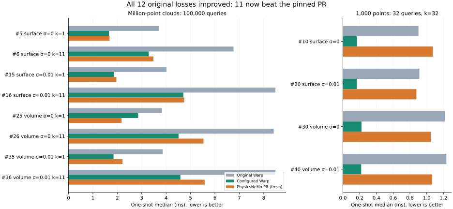

# Profile-guided follow-up: the 12 losing cases

The configured implementation improves **all 12 original losses by 1.34–5.65×**; **11 of those 12 now beat the pinned PhysicsNeMo PR**. Across the full 42-case matrix it wins **41/42**, with a **2.56× geometric-mean speedup** against a fresh run of the unchanged PR. The remaining loss is case 25, discussed below. Close wins in cases 5 and 16 have overlapping timing ranges and should not be treated as robust margins.

With the original leaf size and query launch configuration, the native changes alone win **31/42**, with a **1.67× geometric-mean speedup** against the fresh PR. The original report was 30/42 and 1.45× against its earlier PR run. The 41/42 result includes explicit workload configurations; it is not an automatic dispatch feature or a universal speed guarantee.

[Implementation commit](https://github.com/alecjacobson/warp/commit/e89c988fca4097b6e5a6ae4ef4ba1377448ce71b) · [Original report](../README.md) · [Full measurements and samples](results.json) · [Profiler stage summary](trace-summary.json) · [Validation log](tests-final.txt)



## Pattern and device audit

The original losses fall into two groups, each occurring for both surface and volume data, with and without Gaussian noise:

- Eight cases have **1,000,000 reference points, 100,000 queries, k=1 or 11**. Construction is expensive: the original LBVH takes approximately 2.86–2.97 ms. A CUPTI trace attributes 1.516 ms to the upward, atomics-dependent hierarchy builder, 0.487 ms to leaf packing, 0.344 ms to the main radix-sort kernel, 0.199 ms to leaf initialization, and 0.159 ms to device memsets. Query work is another substantial cost, especially for k=11.
- Four cases have **1,000 reference points, 32 queries, k=32**. Query time alone is approximately 0.81–1.15 ms. The dense launch places the 32 independent traversals in a single block, allowing at most one SM to work; divergent searches also serialize paths within a warp. Changing block size from 32 to 256 barely changes this. Spreading the queries across blocks is the decisive change.

Points, queries, Morton coding, sorting, traversal, and result generation were already on the GPU. The original trace contains only a tiny BVH descriptor host-to-device copy (about 0.0003 ms in that trace), not a point-cloud round trip. Query timings were already measured using CUDA graphs. Moving data to the GPU or merely capturing the query therefore cannot explain or fix these losses.

That descriptor copy did reveal a separate capture-lifetime issue: a captured copy could retain the address of a temporary host descriptor. A tiny initialization kernel now receives the descriptor by value, so graph-owned kernel arguments preserve it through replay. Final traces contain device-to-device copies but no host-to-device or device-to-host copies in the profiled construction/planning/query region. Host-side Python allocation and launch submission still exist outside replay; “device resident” does not mean the one-shot call has no CPU work.

LBVH construction, rebuild, refit, and queries are capturable with CUDA memory-pool support enabled. A new test captures full construction plus query, creates another BVH to exercise stack reuse, changes input points, and validates three graph replays. Keep owners alive and warm up compilation before capture. Other constructors retain their existing capture restrictions.

## Retained changes

1. **Parallel radix topology for ungrouped CUDA LBVH.** Each internal node determines its children independently, following [Karras's parallel radix construction](https://research.nvidia.com/publication/2012-06_maximizing-parallelism-construction-bvhs-octrees-and-k-d-trees). Duplicate Morton codes use a deterministic sorted-position suffix. The existing group-aware builder remains in place.
2. **Less construction work and traffic.** Ungrouped clouds use 32-bit keys and a 30-bit sort instead of 64-bit keys. The builder skips the adjacent-delta pass and redundant node clearing, initializes final primitive-leaf metadata once, and packs only internal nodes. Radix prefix lengths can prove a subtree is below the depth limit without walking its parents. Bounds are computed and propagated from maximal packed leaves, leaving unreachable descendants alone. The publication fence/counter protocol uses volatile child-bound reads.
3. **Explicit query configurations.** The comparison harness uses leaf size 32 and GPU Morton ordering for the million-point batches. For Q≤32, it uses leaf size 32 and one active query per 32-thread block (`query_stride=32`, launch `Q*32`, block size 32). This spreads work and avoids inter-query warp divergence while keeping the scalar query API. All other cases retain leaf size 4 and natural ordering. These are measured configurations, not general crossover thresholds. Query-ordering cost is included in one-shot timing; outputs are restored to original query order.
4. **Reproducible profiling and regression coverage.** Added a kernel/CUPTI profiling utility, the full comparison harness, sparse-launch edge tests, duplicate-key and nonzero-AABB tests, and full-construction graph replay coverage. Nearest-neighbor selection, tie rules, distance arithmetic, and gradients are unchanged.

For the representative million-point volume k=11 trace, the new topology kernel takes **0.159 ms**, active bounds **0.394 ms**, packing **0.198 ms**, and the main reference sort **0.165 ms** at leaf size 32. Query ordering adds approximately **0.080 ms** of GPU kernels. Query-only graph timing falls from approximately **5.62 ms** in the original profile to **3.27 ms** with the configured implementation. Typical final million-point construction medians are **1.25–1.28 ms**, with the case-25 outlier noted below.

These are CUDA activity measurements, not hardware-counter measurements. Nsight Systems/Compute are unavailable in this environment, and device performance counters require administrator permission. The traces establish kernel costs and transfers; they do not establish measured occupancy, cache-hit rates, bandwidth saturation, or register-spill rates. The launch geometry plus sparse-launch ablation supports the small-batch explanation; cache/coherence benefits from Morton ordering remain an inference.

## The original 12 cases

All times are one-shot medians in milliseconds. “Same” is the new native builder with the original leaf size 4 and natural query order. “Configured” uses the explicit rules above. “PR” is a fresh measurement of the pinned, unchanged comparison. The last column compares configured Warp with original Warp, not with PR.

| Case | Data | Noise σ | N / Q / k | Original Warp | Same | Configured | PR | Warp improvement |
| --- | --- | --- | --- | ---: | ---: | ---: | ---: | ---: |
| 5 | surface | 0 | 1,000,000 / 100,000 / 1 | 3.696 | 2.189 | 1.660 | 1.681 | 2.23× |
| 6 | surface | 0 | 1,000,000 / 100,000 / 11 | 6.762 | 6.189 | 3.285 | 3.480 | 2.06× |
| 10 | surface | 0 | 1,000 / 32 / 32 | 0.902 | 0.896 | 0.168 | 1.075 | 5.38× |
| 15 | surface | 0.01 | 1,000,000 / 100,000 / 1 | 4.015 | 2.465 | 1.868 | 1.962 | 2.15× |
| 16 | surface | 0.01 | 1,000,000 / 100,000 / 11 | 8.480 | 6.575 | 4.706 | 4.742 | 1.80× |
| 20 | surface | 0.01 | 1,000 / 32 / 32 | 0.912 | 0.906 | 0.166 | 0.877 | 5.51× |
| 25 | volume | 0 | 1,000,000 / 100,000 / 1 | 3.827 | 2.342 | 2.852 | 2.172 | 1.34× |
| 26 | volume | 0 | 1,000,000 / 100,000 / 11 | 8.409 | 6.526 | 4.509 | 5.532 | 1.86× |
| 30 | volume | 0 | 1,000 / 32 / 32 | 1.219 | 1.218 | 0.222 | 1.049 | 5.49× |
| 35 | volume | 0.01 | 1,000,000 / 100,000 / 1 | 3.859 | 2.355 | 1.846 | 2.213 | 2.09× |
| 36 | volume | 0.01 | 1,000,000 / 100,000 / 11 | 8.483 | 6.565 | 4.585 | 5.580 | 1.85× |
| 40 | volume | 0.01 | 1,000 / 32 / 32 | 1.235 | 1.240 | 0.218 | 1.066 | 5.65× |

The scan cases remain wins: approximately **0.981 vs 1.289 ms** and **1.328 vs 1.746 ms**. The scan is the original report's unresampled Open3D/Redwood RGB-D point-cloud fragment, already preprocessed upstream; it is not raw sensor depth frames. Surface samples, volume samples, noise, seeds, and the scan archive are unchanged.

## Remaining loss and timing uncertainty

Case 25 (noise-free volume, N=1,000,000, Q=100,000, k=1) records **2.852 ms** configured one-shot versus **2.172 ms** for PR. Warp's samples span **2.216–5.107 ms**, with a **4.507 ms wall-time median**. Its captured rebuild, query ordering, and query path takes **1.687 ms**. That path reuses existing output storage, so it is a different lifecycle and must not replace the one-shot comparison.

An isolated 150-sample probe of the same Warp one-shot operations records approximately **1.78 ms** medians with Python garbage collection enabled, disabled, and re-enabled. No collection occurs inside the measured samples, and disabling collection makes no meaningful difference. This does **not** establish garbage collection as the cause. It also does not reproduce the complete matrix's allocator and process history. Host submission, allocation history, and scheduling remain possible causes; the discrepancy is unresolved. We retain the full-matrix loss rather than substituting the faster isolated samples. See [probe data](gc-probe.json) and [probe output](gc-probe.txt).

## Experiments that informed the choice

- **Sparse-launch ablation:** at leaf size 4 on the volume Q=32 case, query time moves from 1.133 ms dense to 0.421, 0.277, 0.166, and 0.119 ms as query stride increases through 4, 8, 16, and 32. The surface case similarly moves from 0.817 to 0.083 ms. Merely changing dense block size does not help. Leaf size 8 can be slightly faster than the chosen common leaf size 32 for these tiny cases; the configured result is not an exhaustive per-case optimum. [Ablation data](radix-probe.json)
- **Larger leaves and query ordering:** on the million-point volume k=11 case in the initial radix-builder probe, natural/ordered query times are 5.100/4.411 ms at leaf size 4 and 3.610/3.272 ms at leaf size 32. The full matrix includes ordering and construction costs. Applying ordering to medium-sized clouds regressed some one-shot cases, so those retain natural order. [Ablation data](radix-probe.json)
- **Fixed-size Morton chunks:** prepacking consecutive points into fixed chunks reduces construction to roughly 0.5–0.9 ms but makes queries several times slower. Broad leaf bounds and extra candidates defeat the build saving. Rejected. [Measurements](compact-probe.json)
- **Cached near-child metadata:** the tested traversal variant was slightly slower. Rejected; the production point-query traversal is unchanged. [Measurements](traversal-probe.json)
- **Cooperative leaf reduction and leaf compaction:** extra kernels and staging increased construction cost by roughly 0.2 ms in the tested configuration. Rejected.
- **Morton-neighborhood bound seeding:** binary-searching candidate windows can help some leaf-size-8 configurations, but slows the chosen leaf-size-32 configuration. Rejected. [Measurements](seed-probe.json)

The ablation files are exploratory runs at intermediate source states; they explain decisions, not final performance claims. The final 42-case file and final profiles were collected after the last native build. A next investigation should reproduce case 25 in the full process history and instrument CPU submission/allocation gaps; the remaining large-k query cost and active-leaf bounds reduction are also concrete targets for further work.

## Validation and provenance

- **81 tests passed:** 25 point-query CPU/CUDA groups and 56 existing BVH, grouped-BVH, and mesh-query regression tests. [Test output](tests-final.txt)
- Every final timed variant validates 32 sampled rows against exhaustive float32 and float64 references; all recorded mismatch counts are zero. Captured rebuild/query output is checked separately. This samples large benchmark outputs rather than exhaustively validating all of them.
- Native build, formatting/lint, and documentation build passed. [Build](build-final.txt) · [Lint](lint.txt) · [Docs](docs-final.txt)
- GPU: NVIDIA RTX PRO 6000 Blackwell Server Edition, MIG 1g.24gb, 46 SMs; driver 595.91.07; CUDA toolkit 12.9; Python 3.12; PyTorch 2.7.1+cu128. Native baseline and final code both use the quick build's compute-75 PTX, while runtime query kernels target sm_120. These measurements are specific to this configuration.
- PhysicsNeMo source is pinned to `bc1c912528f0409c6853dbd33e00346a9184185c`, source SHA-256 `01255c7377bcb65aa13d5c6d75acd5ef346a1799e014b410974bf6205506b85c`. Both sides return int64 indices and float32 Euclidean distances. Construction, output allocation, and any query-ordering work are charged to one-shot time. Inputs begin resident on device, as in the original report.
- Seven timing samples per measurement; query and rebuild graph timings use 20 replays per sample. One-shot measurements use the original timing helper, with no garbage-collection suppression. CPU wall-time medians and all GPU-event samples are retained. No simultaneous GPU benchmarks ran.
- The `git_revision` in the final JSON is the pre-commit parent `e8fd6fc`; `native_bvh_sha256` and `wrapper_sha256` identify the exact tested working-tree source. The commit containing this report follows the implementation commit.

## Reproduction

Use the environment setup and dataset download from the [original reproduction instructions](../reproduce.rst), then:

```bash
uv run --no-sync build_lib.py --quick --cuda-path /tmp/warp-intersection-cuda-12.9
uv run --no-sync -m unittest warp.tests.geometry.test_point_query warp.tests.geometry.test_bvh warp.tests.geometry.test_mesh_query_point warp.tests.geometry.test_grouped_bvh -q
uv run --no-sync -m warp.examples.benchmarks.benchmark_point_query_optimization --output /tmp/knn-optimization/results.json --scan ../data/DemoICPPointClouds.zip --repeats 7
uv run --no-sync -m warp.examples.benchmarks.profile_point_query --output /tmp/knn-profile-leaf4 --trace
uv run --no-sync -m warp.examples.benchmarks.profile_point_query --output /tmp/knn-profile-leaf32 --leaf-size 32 --ordered --trace
uv run --no-sync -m warp.examples.benchmarks.profile_point_query --output /tmp/knn-profile-small --points 1000 --queries 32 --k 32 --leaf-size 32 --query-stride 32 --trace
```

Adjust the local CUDA toolkit and dataset paths. Run GPU commands sequentially. `--losses-only` provides a shorter rerun of the original 12 cases; the headline above uses the complete 42-case run.

The profiler's `construction_activities` list uses Warp's CUDA activity timers, which omit CUB-internal launches; the accompanying CUPTI trace includes them. The final explicit synchronization in the profiler closes the measurement region and should not be mistaken for hidden synchronization in construction. Profiling overhead means trace durations are diagnostic rather than substitutes for unprofiled benchmark medians.

Download and decompress the [original trace](before-trace.json.gz), [new leaf-size-4 trace](leaf4-trace.json.gz), [configured million-point trace](leaf32-trace.json.gz), or [small-batch trace](small-trace.json.gz), then open the JSON in a Chrome/Perfetto-compatible trace viewer. Compact activity and graph-timing files: [before](profile-before.json), [leaf size 4](profile-leaf4.json), [leaf size 32](profile-leaf32.json), [small batch](profile-small.json).
