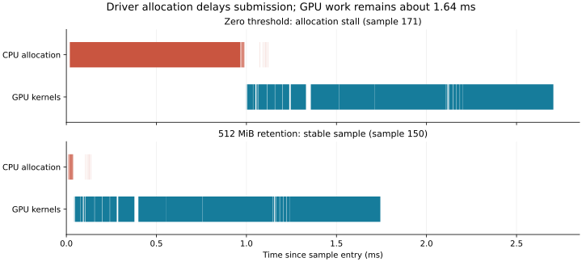

# Case 25: allocator stalls, not a difficult nearest-neighbor workload

The last recorded loss has a reproducible **CUDA allocation/submission bottleneck**. The pool release threshold was **zero**. Synchronizing between samples allowed freed storage to be returned to the driver, so the two warmup calls did not guarantee that subsequent calls would reuse resident memory. A traced slow call spends **1.92 ms in two `cudaMallocAsync` calls**, while its GPU kernels still total **1.64 ms**; GPU-event elapsed time rises to **3.66 ms**. A second, independently reproduced stall spends **0.95 ms in one allocation**, giving **2.68 ms** elapsed with essentially the same GPU work.

With an explicit **512 MiB release threshold**, the complete 42-case rerun wins **42/42** using the previously documented query configurations, with a **2.61× geometric-mean speedup** against a fresh run of the unchanged PhysicsNeMo PR. Case 25 takes **1.717 ms versus 2.170 ms**, a **1.26× speedup** (about 21% less time). Its seven samples span **1.715–1.731 ms**, compared with **2.216–5.107 ms** in the original losing run.

This is an allocator-policy improvement. The native BVH and point-query sources are unchanged from the previous optimization. The original zero-threshold result remains archived; this does not retroactively change its 41/42 count. No trace was recorded during that historical outlier, so we cannot attribute every microsecond of that particular run. The new traces reproduce the same kind of loss and directly locate the delay in allocation calls.

[Diagnostic implementation](https://github.com/alecjacobson/warp/commit/503e6a64aa7899d6eb75ce3d96fbc5c3e1a60b82) · [Previous report](../README.md) · [Full retained-pool matrix](results-retained-pool.json) · [Alternating-policy experiment](allocator-results.json) · [Trace summaries](trace-summary.json)



## How the diagnosis was established

1. **Reproduce the exact case in isolation.** The same million-point, noise-free volume cloud, 100,000 queries, k=1, seed 531, leaf size 32, and Morton query ordering runs at approximately 1.82–1.85 ms. The input itself does not require a 2.85 ms search. [Initial results](initial.json)
2. **Replay the preceding workload history.** Cases 1–25 were run sequentially with the original validations and paired configurations. Case 25 then takes 1.828 ms versus 2.173 ms for PR, while a similar spike migrates to the earlier million-point surface case. The slow surface samples show millisecond-scale CPU submission cost without page faults, involuntary scheduling interruptions, or coincident garbage collection. This is inconsistent with a bottleneck specific to the volume distribution. [Selected measurements and host instrumentation](sequence-selected.json)
3. **Inspect CUDA calls, not only kernels.** CUPTI catches millisecond allocation calls in otherwise normal construction. In the exploratory large stall, two `cudaMallocAsync` calls take 0.593 and 1.328 ms. In the checked-in diagnostic's independently reproduced stall, one takes 0.945 ms. The latter sample's GPU kernel total is 1.639 ms, and its measured GPU-event interval is 2.681 ms. Event intervals include GPU idle time waiting for later host submissions; they are not sums of kernel execution times. [Large-stall trace](exploratory-large-stall-trace.json.gz) · [Independent stall trace](allocator-stall-trace.json.gz)
4. **Change only the memory retention policy and reverse it.** An alternating zero/512/zero/512 MiB experiment keeps data, algorithms, output allocation, destruction of prior results, ordering work, and synchronization semantics fixed. Both implementations are measured in alternating order, 60 samples each per phase. The allocator penalty returns when the threshold returns to zero. Separate profiled samples locate the affected CUDA calls. [Reproducible diagnostic source](../../../../warp/examples/benchmarks/benchmark_point_query_allocator.py)
5. **Rerun the full matrix with the policy recorded.** The unchanged search configuration plus retained memory wins all 42 measured cases. Case 25's wall-time median is 1.727 ms, close to its 1.717 ms event interval. The query-only graph remains approximately 0.480 ms, and captured rebuild/order/query remains approximately 1.690 ms. These do not show an algorithmic regression. [Full run output](retained-matrix.txt)

## Controlled measurements

Unprofiled one-shot times below are milliseconds. The new diagnostic records garbage collections without disabling them and separates profiled from unprofiled samples.

| Phase | Release threshold (MiB) | Warp event median | Warp wall median | Warp event range | PR event median |
| --- | ---: | ---: | ---: | ---: | ---: |
| 1 | 0 | 1.816 | 1.965 | 1.769–1.902 | 2.226 |
| 2 | 512 | 1.731 | 1.742 | 1.710–1.752 | 2.225 |
| 3 | 0 | 1.824 | 1.904 | 1.779–1.868 | 2.234 |
| 4 | 512 | 1.730 | 1.742 | 1.714–1.746 | 2.225 |

In a preliminary paired experiment, CPU time inside the 20 `cudaMallocAsync` calls per Warp one-shot drops from approximately **0.14 ms to 0.015 ms** when retaining memory (about 9×). In the longer checked-in diagnostic, those profiled averages are approximately **0.09–0.11 ms versus 0.022–0.023 ms**. Profiler overhead and occasional stalls affect these averages, so neither should be confused with unprofiled application latency. Kernel timings remain essentially unchanged: topology about 0.158 ms, packed-leaf bounds about 0.395 ms, packing about 0.199 ms, and query about 0.50 ms in the preliminary traces. [Preliminary samples and memory statistics](exploratory-pool-probe.json)

The preliminary memory probe observes roughly **160–192 MiB reserved** after synchronization at zero threshold, versus **416 MiB** with retention, with about **96 MiB actually used** by live Warp pool allocations in that probe. These are process-history-dependent observations, not a fixed memory requirement. A 512 MiB release threshold is neither a 512 MiB preallocation nor a hard allocation cap: it controls when unused pool memory may be released. The appropriate value depends on the application's concurrent allocations and memory budget.

The PR uses PyTorch's **native caching allocator**, recorded in the new metadata. It retains storage through these synchronizations already, so the two original implementations did not have equivalent memory-retention behavior even though both allocated fresh logical outputs each call. The CUDA pool setting applies throughout the new run to any allocations using that pool; the PR source and PyTorch allocator backend are unchanged.

CUDA documents the zero default threshold and release at synchronization in its [stream-ordered allocator explanation](https://developer.nvidia.com/blog/using-cuda-stream-ordered-memory-allocator-part-1/). This explains why merely adding two warmup calls failed to stabilize a loop that synchronizes each iteration. The evidence does not determine the driver's internal reason for every slow allocation, such as a particular mapping, page-management, or lock path; CUPTI identifies the slow API boundary, not those internals.

## Scope and remaining limits

- The retained-pool full matrix uses exactly the previous explicit query configurations: leaf size 32 plus Morton ordering for million-point batches, leaf size 32 plus sparse launches for Q≤32, and leaf size 4 with natural ordering otherwise. With the original leaf size and launch configuration, this new run wins **30/42**, not 42/42. Small close-call counts vary between runs; they should not be presented as robust margins.
- Retention removes the demonstrated pool-release/reacquisition penalty. It cannot eliminate unrelated host scheduling, garbage collection, first-use loading, or profiling overhead. The longer diagnostic records those events where available; a warm-pool tail spike should still be investigated rather than automatically attributed to allocation.
- The large original spike is not a typical algorithmic cost: even zero-threshold repeats often win case 25. The defensible claim is a reproduced allocator-stall mechanism and a controlled improvement, not that every zero-threshold call must lose.
- CPU/GPU timings and all samples remain separate. Profiling traces are diagnostic; the 42/42 claim uses an unprofiled run with seven samples per measurement. Hardware counters remain unavailable, and no bandwidth, cache-hit, or occupancy claim is made.
- No native algorithm, global Warp allocator default, or PhysicsNeMo implementation was changed in this follow-up. The new benchmark flag is opt-in. Users of persistent BVHs and captured replay already avoid much of this per-call allocation cost.

## Changes and validation

Added `benchmark_point_query_allocator` for the paired policy experiment, CPU submission breakdown, optional CUPTI traces, garbage-collection correlation, and policy restoration on exit. Added `--mempool-release-threshold-mib` and actual allocator metadata to the full comparison harness. The flag is omitted by default, preserving the caller's existing pool policy.

The full 42-case rerun checks sampled outputs for both configurations, graph replay, and PR; all recorded float32 and float64 mismatch counts are zero. The new diagnostic checks both implementations after every policy phase, also with zero mismatches. Formatting/lint and the documentation build pass. The native source hash is identical to the prior implementation that passed 81 geometry tests; no new native build or repeated geometry suite was needed for this measurement-only follow-up.

[Lint](lint.txt) · [Documentation build](docs.txt) · [Diagnostic output](allocator.txt)

## Reproduction

Use the environment and dataset from the [original reproduction instructions](../../reproduce.rst). Run sequentially on the same GPU:

```bash
uv run --no-sync -m warp.examples.benchmarks.benchmark_point_query_allocator --output /tmp/knn-allocator --trace
uv run --no-sync -m warp.examples.benchmarks.benchmark_point_query_optimization --output /tmp/knn-retained/results.json --scan ../data/DemoICPPointClouds.zip --repeats 7 --mempool-release-threshold-mib 512
```

The diagnostic defaults to 60 paired unprofiled samples and 300 additional profiled Warp samples per phase. It restores the initial threshold even on error. Omit `--trace` for the shorter unprofiled experiment. The full matrix is a CLI process; its explicit policy lasts for that process. To apply the same policy in an application with an appropriate memory budget:

```python
previous = wp.get_mempool_release_threshold("cuda:0")
try:
    wp.set_mempool_release_threshold("cuda:0", 512 * 1024**2)
    # Repeated one-shot builds and queries; allow freed storage to be reused.
finally:
    wp.set_mempool_release_threshold("cuda:0", previous)
```

Download and decompress the [stall trace](allocator-stall-trace.json.gz) or [retained-pool trace](retained-pool-trace.json.gz) to inspect in a Chrome/Perfetto-compatible viewer. These are selected sample windows from longer traces, with original timestamps and events preserved; the selection is recorded inside each file. Full long traces remain in the local investigation artifacts and are reproducible with the diagnostic. The full-matrix JSON records the pre-commit parent because it was collected before committing these harness additions; native and wrapper hashes identify the unchanged tested implementation.
