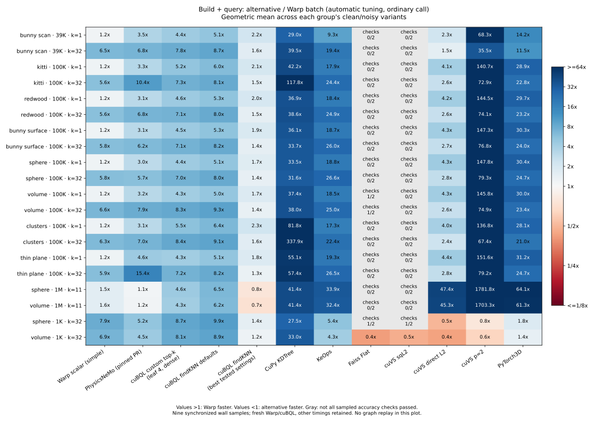
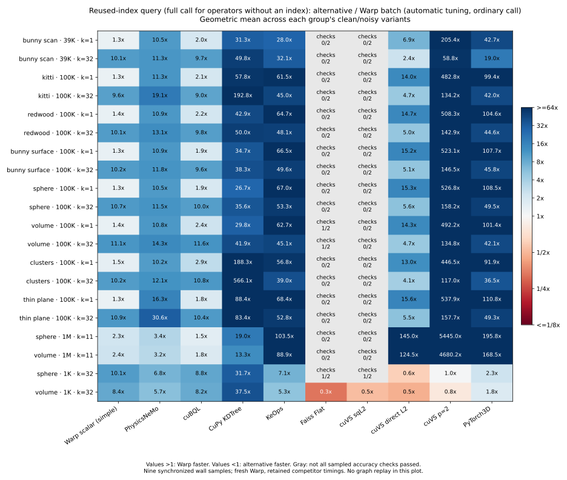

# Fresh GPU kNN comparison — November 12, 2026

**Configured Warp is fastest among accuracy-passing exact alternatives in 36/40 cases, both for build-plus-query and reused-index search.** All 36 wins exceed 5%; all four losses are tiny N=1,000, Q=32 cases. The earlier full sweep had 16/40 build-plus-query wins and 11/40 reused-index wins. All 11 exact configurations completed all 40 cases: **440 measured configuration/case pairs**. CAGRA was excluded before running, as requested.

| Regime | Cases | Warp fastest build + query | Warp fastest reused index | Best competing latency / Warp, build + query | Best competing latency / Warp, reused index |
| --- | ---: | ---: | ---: | ---: | ---: |
| N=39K/100K, Q=1,024, k=1 | 16 | 16 | 16 | 2.40–4.51x | 1.39–2.76x |
| N=39K/100K, Q=1,024, k=32 | 16 | 16 | 16 | 1.54–3.17x | 2.27–6.35x |
| N=1M, Q=8,192, k=11 | 4 | 4 | 4 | 1.11–1.18x | 1.53–1.86x |
| N=1K, Q=32, k=32 | 4 | 0 | 0 | 0.42–0.50x | 0.33–0.62x |

The closest competitors are direct-L2 cuVS for medium k=32, pinned PhysicsNeMo for million-point build-plus-query, and cuBQL for medium k=1/million-point reused-index search. cuVS or Faiss wins the tiny cases: about **2.0–2.4x faster** including construction and **1.6–3.1x faster** with reused indexes. Per-case numerical failures are excluded when selecting the best competitor; Faiss's broader failures are still reported below.

## Pairwise results

These geometric means use passing cases for both methods. Rows with different denominators must not be ranked as though they cover the same workloads. All methods completed 40 cases; a smaller denominator indicates numerical failures, not a failed or omitted timing run.

| Alternative | Warp lower median, build + query | Alternative / Warp GM | Warp lower median, reused index | Alternative / Warp GM |
| --- | ---: | ---: | ---: | ---: |
| Pinned PhysicsNeMo | 40/40 | 4.58x | 40/40 | 10.36x* |
| Direct cuBQL | 40/40 | 6.21x | 40/40 | 4.41x |
| CuPy KDTree | 40/40 | 48.45x | 40/40 | 50.60x |
| KeOps | 40/40 | 19.30x | 40/40 | 43.62x* |
| Faiss Flat | 2/5 | 1.80x | 2/5 | 2.19x |
| cuVS expanded L2 | 0/3 | 0.50x | 0/3 | 0.57x |
| cuVS direct L2 | 36/40 | 3.52x | 36/40 | 7.84x |
| cuVS Minkowski p=2 | 36/40 | 81.40x | 38/40 | 183.90x |
| PyTorch3D | 40/40 | 21.15x | 40/40 | 47.81x* |

*These adapters expose a complete operator, not a reusable index; that full call is compared with Warp's reused-index search. This is an application-level comparison, not an isolated traversal-kernel ratio. The default dense Warp configuration is also measured: configured Warp leads it 40/40, by 2.57x geometrically averaged including construction and 3.73x with reuse.

The cuBQL query gap is now closed on this matrix: it previously beat configured Warp in 13/40 reused-index cases, whereas Warp now has lower medians in all 40. Medium k=32 also reverses the earlier result, with Warp now ahead of direct-L2 cuVS in all 16 cases.

[Accuracy-filtered table and graph checks](table.md) · [All timed cases, including numerical failures](all-timed-table.md) · [Reused-index table](query-table.md) · [Best competitor per build-plus-query case](best-one_shot.json) · [Best competitor per reused-index case](best-reused_index_search.json)

## Equally tuned PhysicsNeMo control

A separate fresh run applies the same isotropic Morton scaling and sparse-query launch policy to PhysicsNeMo, clearly labeled as an experimental variant. It compares all three methods against the same inputs with nine samples and its own contemporaneous Warp timings. All 120 method/case pairs pass sampled accuracy checks; these are supplemental to the 440 pairs above.

Warp has lower medians in **37/40**, with **36 wins greater than 5% and four near ties**. The geometric-mean ratio is **2.52x**. All four million-point cases are within 5%: tuned PhysicsNeMo has lower medians on three, Warp on one. Thus the advantage over the pinned PR in that regime should not be presented as a robust advantage over equally tuned PhysicsNeMo. The earlier control had two million-point wins each; the fresh split illustrates why those small differences are treated as ties.

The same control beats pinned PhysicsNeMo 40/40 (4.67x GM), consistent with the main sweep's 4.58x. Current Warp one-shot timings are about 2.8% higher geometrically averaged than the preceding hybrid run, with unchanged code; this is a reminder that small margins vary between runs. Compared with the pre-improvement broad sweep, current Warp is 2.43x faster geometrically averaged. That historical comparison also includes the documented stream-policy change, so it is not a pure kernel ablation.

[Tuned-control raw data](results/tuned-control.json) · [Variant hashes and environment](results/tuned-control.environment.json)

[Reproduce](reproduce.md) · [Per-case CSV](cases.csv) · [Summary](summary.json) · [Regime analysis](analysis.json) · [Raw results](results/) · [Frozen datasets](manifest.json)

## Timing and scope

This is a fresh run of all 11 exact configurations on the same 40 point-cloud cases, after the [Warp geometry and scheduling improvements](../hybrid/README.md). It measures commit `197ffeeea97ed94352a01ee67c3c852accb92731`; neither the Warp algorithm nor the library adapters changed for this run. Library versions, external source pins and input arrays are held fixed. This is a performance rerun, not an upgrade to newer library releases.

**All speed ratios are alternative latency / configured Warp latency; greater than one favors Warp.** Primary times are synchronized wall medians of nine samples after two warmups. Build-plus-query includes construction, query planning, output allocation/conversion, sorting, host submission and retirement of prior results. Inputs are already on device; upload and JIT compilation are excluded. Raw samples include supplemental CUDA-event times.

For reused-index search, explicit indexes are built before timing. PhysicsNeMo, KeOps and PyTorch3D expose complete operators in these adapters, so their full calls remain in that comparison. In particular, the PhysicsNeMo reused-index ratio is not a comparison against its raw traversal kernel.

The configured Warp path applies the existing GPU-aware query-spacing and leaf-size policy; it is not automatic dispatch in the scalar API. Default Warp uses dense launches and leaf size 4. All methods use the same Warp-owned blocking stream where supported, the same lifetime-safe policy as the hybrid investigation. Explicit allocator policies are unchanged; this is not an equal-memory-budget experiment.

The cases include Stanford Bunny scan vertices, KITTI LiDAR, a Redwood RGB-D fragment, mesh/sphere surfaces, uniform volumes, clusters/outliers and thin planes, each with and without Gaussian noise. Medium cases have N=39,232 or 100,000 and Q=1,024 at k=1/32; large cases have N=1M, Q=8,192, k=11; tiny cases have N=1,000, Q=32, k=32. Source terms, disjoint scan sampling and noise construction are documented in the [original dataset report](../comparison/README.md#dataset-coverage). Arrays and source archives remain outside Git.

## Numerical accuracy and capture

Numerical failures stay in the raw timing table and are excluded from accuracy-filtered rankings. Passing means all-row structural checks plus exhaustive float64 reference distances for 32 evenly spaced query rows, not exhaustive validation of every query. Differences from that oracle are reported even for nominally exhaustive float32 methods.

Faiss Flat passes 5/40 one-shot cases: five cases have neighbor-distance rank mismatches and 35 have reported-distance mismatches; minimum sampled recall is 0.84375. Default expanded-L2 cuVS passes 3/40: nine cases have rank mismatches and 37 have reported-distance mismatches; minimum sampled recall is 0.00284. These categories overlap. Direct-L2 cuVS passes all 40. This reproduces the earlier numerical distinction and does not justify treating the fastest expanded-distance numbers as interchangeable with the direct-distance contract. See the [earlier precision investigation](../comparison/README.md).

CuPy KDTree and KeOps fail the small query-capture probe, as before. CuPy attempts a device-to-host scalar read during capture; KeOps's public path fails CUDA capture. These are limitations of the tested adapters and pinned versions, not claims about every possible implementation in those projects. Probe errors are retained in the result JSONs and logs. The other nine configurations pass capture and changed-query validation on the probe. Capture success on that small input does not override the numerical failures in the main matrix.

A fresh [full-call probe](results/full-capture.json) also passes for Warp, pinned PhysicsNeMo and the isotropic/tuned variants: it captures construction plus query and validates three replays after changing both reference points and queries. All four variants pass every recorded validation.

## Limits and evidence

The GPU is one 46-SM RTX PRO 6000 Blackwell MIG slice. Clocks are not locked, and this is a shared VM. A 5% band is descriptive, not a confidence interval or significance test. The geometric means weight the chosen cases equally; they do not predict application runtime or generalize to other GPUs, high-dimensional embedding search, arbitrary k, or other query/reference ratios.

This rerun covers the original 40-case matrix. The earlier 56 holdouts remain separate evidence from the hybrid investigation; they are not fresh measurements against every library. CAGRA is excluded at the user's request: the earlier build-plus-query cost was orders of magnitude higher, and approximate search is outside this comparison. No fresh CAGRA run was performed.

[Source and native-binary hashes](provenance.json), [hardware snapshot](hardware.txt), [environment freeze](environment-freeze.txt), [process outcomes](results/processes.json), and complete samples make the run reviewable. The existing benchmark oracle/data suite passes [all eight tests](results/tests.log). No native code changed, so the existing native build and core test evidence in the [hybrid report](../hybrid/README.md#correctness-device-residency-and-capture) apply to the same implementation.
