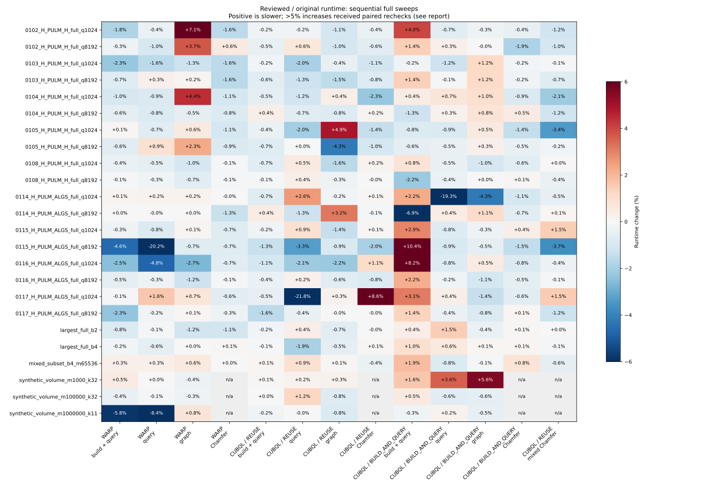

# kNN review and PR validation

Reviewed **2026-11-16**, authored by **Codex**. Implementation: [`alecjacobson/knn-review`](https://github.com/alecjacobson/warp/tree/alecjacobson/knn-review), commit [`1e11e4f430bf`](https://github.com/alecjacobson/warp/commit/1e11e4f430bfda8cc01e95daa82625f6a92331ec), based on NVIDIA main `eb5d91725`. References [NVIDIA/warp#2348](https://github.com/NVIDIA/warp/issues/2348).

The research branch retains the experiments. The PR contains 30 implementation, test, documentation, changelog, and ASV benchmark files in one signed-off commit. It excludes historical reports and experimental benchmark implementations. The public API remains `wp.geometry.PointIndex` / `wp.geometry.knn`, with scalar kernel queries using `wp.Bvh(lowers=points, uppers=points)`.

## Review fixes

- Reject invalid `leaf_size` even when the batch count is zero. The new regression test failed for all four invalid values before the fix and passes afterward. Validation is shared by construction and querying.
- Return zero Euclidean-distance subgradients at coincident coordinates. `squared=False` previously produced NaNs during backward on both CPU and CUDA. The regression also checks a positive distance of `1e-7`, so fixing zero does not suppress small-distance gradients. Both available backends are covered.
- Remove experimental benchmark imports from core tests. Preserve scalar sparse-launch coverage locally, and explicitly force/check traversal-stack restart. Respect builds without cuBQL when enumerating constructors.
- Consolidate the changelog under issue 2348, update docs, use current array annotations/kernel naming, and add an ASV benchmark for build+query, reused queries, and graph replay across 24 parameter combinations.

Native sources, vendored cuBQL, native library, and query tuning are unchanged by the review fixes. No native rebuild was needed. [Provenance](provenance.json) identifies the exact source and library; the timed geometry implementation matches the final commit.

## Correctness and tooling

Platform: Ubuntu 24.04 x86_64, NVIDIA RTX PRO 6000 Blackwell MIG 2g.48gb, 94 SMs, driver 595.58, CUDA compilation toolkit 12.9.1.

- **198 existing geometry tests passed:** BVH, mesh construction, mesh AABB/point/ray queries, intersection/hash, hash grids, and the newly rebased triangle-intersection module.
- **391 kNN/runtime/code-generation tests ran, with 4 skips:** 387 passed. Combined with the geometry run, **585 passed and 4 skipped**. The shared kernel cache was retained.
- **51 focused kNN tests passed again** after excluding research files from the PR tree. This repeats part of the 391-test run, not additional distinct coverage.
- Strict Sphinx build and all applicable pre-commit hooks passed. An incremental Sphinx attempt encountered pre-existing generated redirect pages; the final standard clean build passed.
- All **24 ASV parameter combinations / 72 timing methods** passed a smoke run. Scalar CPU, fused CUDA, and symmetric Chamfer examples passed; Warp/Warp and cuBQL/Warp losses decreased from approximately 0.31043 to 0.15786.
- CUDA synccheck passed partial/oversized point-leaf construction. Memcheck passed five focused CUDA cases covering leaf boundaries, captured single-cloud construction, stack restart, batched results, and native cuBQL dispatch.

### Captured allocation diagnostic limitation

Full captured batched construction produces invalid-write reports under Compute Sanitizer, despite passing normal value checks and replay tests. This was **not** dismissed or reported as a clean sanitizer run.

[The standalone CUDA reproducer](graph_reuse.cu), with **no Warp dependency**, reproduces the same report using a serial captured sequence of allocations, writes, copies, and frees. Normal execution checks every copied value successfully. Adding the `defer` argument delays frees until the end of capture and passes memcheck. The same issue reproduced with sanitizer packages 12.9.79 and 13.2.23 (tool version 2026.1.0.0). The captured Warp graph is a fully ordered chain; scratch is freed after use and its address range is reused by later retained allocations.

These controls point to a graph-memory-reuse sanitizer limitation on this environment, rather than an out-of-bounds Warp access. Broader hardware/driver confirmation remains useful. No synchronization or allocation workaround was added to the library merely to hide the diagnostic.

```bash
/home/horde/cuda/12.9.1/bin/nvcc -std=c++17 -arch=sm_120 --cudart shared graph_reuse.cu -o graph_reuse
./graph_reuse
/home/horde/cuda/12.9.1/bin/compute-sanitizer --tool memcheck --error-exitcode 91 ./graph_reuse
/home/horde/cuda/12.9.1/bin/compute-sanitizer --tool memcheck --error-exitcode 91 ./graph_reuse defer
```

## Performance

The baseline is published branch commit `fb53789563df`; the after run measures the reviewed implementation on current NVIDIA main. Both use the same archive, deterministic queries, three public configurations, 24 workloads, two warmups, and **15 measured repetitions**. Timings are synchronized wall times, including Python and allocation work. The configurations are `backend=wp.geometry.PointQueryBackend.WARP`, and `backend=wp.geometry.PointQueryBackend.CUBQL` with `objective=wp.geometry.PointQueryObjective.REUSE` or `BUILD_AND_QUERY`.

The sweep includes full pulmonary clouds, independent batches, synthetic k=11/32, ordinary queries, graph replay, and symmetric Chamfer forward/backward. There are **300 timing comparisons**. Retained index/output CUDA-pool bytes match in **72/72** comparisons; this is retained memory, not peak training memory. The initial after sweep overlapped the end of documentation/formatting work, so all increases above 5% received an isolated paired check below.

Positive percentages mean slower. Values are geometric means of per-case median ratios.

| Workload | Comparisons | Reviewed / original |
| --- | ---: | ---: |
| Build + query | 72 | -0.05% |
| Reused query | 72 | -1.33% |
| Query graph | 72 | +0.01% |
| Chamfer forward/backward | 63 | -0.38% |
| Mixed-backend Chamfer | 21 | -0.66% |



[Every median](cases.csv), [summary](summary.json), [before samples](before.json), [after samples](after.json).

### Recheck every increase above 5%

The five largest increases in the separate full sweeps were remeasured using original and reviewed Python implementations on identical arrays, alternating order over **three rounds of 31 repetitions**. Both versions used the same native library, which was unchanged. Query generation reproduces all RNG consumption from the full sweep.

| Case / phase | Initial increase | Paired geometric mean |
| --- | ---: | ---: |
| `0115...q8192`, cuBQL build+query | +10.36% | −0.51% |
| `0117...q1024`, cuBQL reused-target Chamfer | +8.58% | +0.68% |
| `0116...q1024`, cuBQL build+query | +8.19% | +1.11% |
| `0102...q1024`, Warp query graph | +7.09% | −0.21% |
| `synthetic_m1000_k32`, cuBQL query graph | +5.57% | +1.33% |

No repeatable performance regression was identified. Small differences are not confidence bounds or guarantees on other hardware. [Paired samples](investigation.json) and [recheck script](investigate.py) preserve the investigation.

The [existing external-library comparisons](../comparisons.md) remain a separate experiment. External libraries were not modified or rebenchmarked during this correctness review.

## Reproduction and scope

The complete sweep uses the harness retained on the research branch:

```bash
uv run --no-sync -m warp.examples.benchmarks.benchmark_point_query_api_revision \
  --archive pulmonary_point_clouds.zip --output after.json --repeats 15
```

The PR intentionally excludes that experimental harness. The maintained benchmark is `asv/benchmarks/point_query.py`. Reports retain compressed validation logs; raw point-cloud data and compiled binaries are excluded.

Related open upstream work: [LBVH depth handling, #2265](https://github.com/NVIDIA/warp/pull/2265) overlaps the shared builder; [bounds-reduction synchronization, #1863](https://github.com/NVIDIA/warp/pull/1863) concerns pre-existing code retained by this branch. Neither unmerged PR was imported. The existing BVH/mesh suites passed against the branch's builder. Wider hardware coverage and these upstream changes should be coordinated during upstream review.

For the paired recheck, use the reviewed checkout with the experimental benchmark helpers restored from the research branch as uncommitted tooling, then run `PYTHONPATH=. uv run --no-sync reports/knn/review-2348/investigate.py`. The script loads the original implementation from its pinned Git commit; its `reviewed` import must come from the PR implementation. The raw measurements and hashes above are authoritative for this recorded run.
